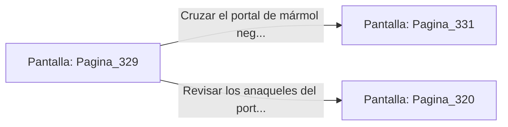

# 📺 Nodo Pantalla: `Pagina_329`

[[Index|⬅️ Índice]] | Fichero Origen: [[sample_eligejuego-code_capitulo_17_mpl|📄 sample/eligejuego-code/capitulo_17.mpl]]

**Narrativa y Encabezado:**
> PÁGINA 329: LA RUTA DE DRENAJE DEL BASTIÓN
> 
> Avanzas por el canal de drenaje purificado. La corriente de agua de éter limpio limpia las toxinas de tus botas y devuelve la frescura a tu rostro tras el calor de las forjas.
> 
> Al final del canal se erige un portal de mármol negro decorado con la runa del Fénix, que señala el acceso directo a los Aposentos del Gran Comandante en el Bastión Superior.
> 
> Verificas la carga de tu armamento antes de cruzar el portal de mármol para encarar las Cámaras del Capítulo 18.

## 📋 Desglose de Instrucciones de Opciones
### `OPCION "Cruzar el portal de mármol negro hacia el Bastión Superior" CON_ACCION TRANSICIONAR_A Pagina_331`
* **Instrucción:** `OPCION` *(Manual: Mapea una entrada o botón interactivo de usuario. Vincular una acción como la invocación de una función C1, un método C2 o una transición C3.)*
* **Efecto de Control:** Dispara `TRANSICIONAR_A` hacia [[Pantalla_Pagina_331|📺 Pagina_331]]
### `OPCION "Revisar los anaqueles del portal en busca de suministros" CON_ACCION TRANSICIONAR_A Pagina_320`
* **Instrucción:** `OPCION` *(Manual: Mapea una entrada o botón interactivo de usuario. Vincular una acción como la invocación de una función C1, un método C2 o una transición C3.)*
* **Efecto de Control:** Dispara `TRANSICIONAR_A` hacia [[Pantalla_Pagina_320|📺 Pagina_320]]

## 📊 Diagrama de Flujo e Interacción (Mermaid)

