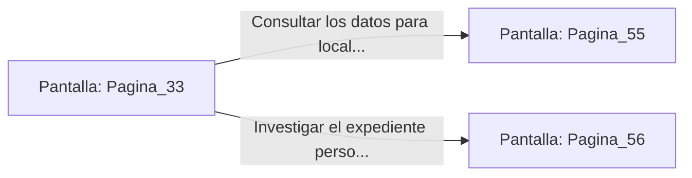

# 📺 Nodo Pantalla: `Pagina_33`

[[Index|⬅️ Índice]] | Fichero Origen: [[sample_eligejuego-code_capitulo_03_mpl|📄 sample/eligejuego-code/capitulo_03.mpl]]

**Narrativa y Encabezado:**
> PÁGINA 33: EL GRAN ARCHIVO DE MNE MÓSINE
> 
> Desciendes con la cuerda desde el techo y te posas en el suelo de parqué petrificado del Gran Archivo. Miles de tomos encuadernados en piel de quimera y cilindros de memoria mnemónica se apilan en estanterías de madera de ébano de veinte metros de altura.
> 
> En el centro de la sala flota un holograma de consulta interactivo. Al aproximarte, la inteligencia artificial del archivo reconoce la firma de tu Brazal y te ofrece acceso a dos registros clasificados: la ubicación exacta del Primer Sello de Fase o el historial de creación del Inquisidor Malakor.
> 
> Debes elegir qué información extraer antes de que las patrullas de custodia detecten la intrusión en el sistema.

## 📋 Desglose de Instrucciones de Opciones
### `OPCION "Consultar los datos para localizar el Primer Sello de Fase" CON_ACCION TRANSICIONAR_A Pagina_55`
* **Instrucción:** `OPCION` *(Manual: Mapea una entrada o botón interactivo de usuario. Vincular una acción como la invocación de una función C1, un método C2 o una transición C3.)*
* **Efecto de Control:** Dispara `TRANSICIONAR_A` hacia [[Pantalla_Pagina_55|📺 Pagina_55]]
### `OPCION "Investigar el expediente personal y las debilidades de Malakor" CON_ACCION TRANSICIONAR_A Pagina_56`
* **Instrucción:** `OPCION` *(Manual: Mapea una entrada o botón interactivo de usuario. Vincular una acción como la invocación de una función C1, un método C2 o una transición C3.)*
* **Efecto de Control:** Dispara `TRANSICIONAR_A` hacia [[Pantalla_Pagina_56|📺 Pagina_56]]

## 📊 Diagrama de Flujo e Interacción (Mermaid)

