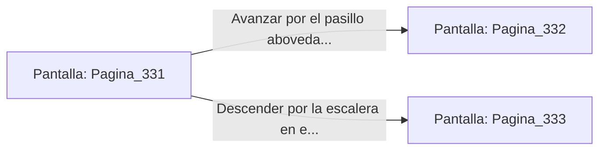

# 📺 Nodo Pantalla: `Pagina_331`

[[Index|⬅️ Índice]] | Fichero Origen: [[sample_eligejuego-code_capitulo_18_mpl|📄 sample/eligejuego-code/capitulo_18.mpl]]

**Narrativa y Encabezado:**
> PÁGINA 331: EL ENTRADA AL BASTIÓN SUPERIOR
> 
> Atraviesas el portal de mármol negro y te internas en la majestuosa antecámara del Bastión Superior. Grandes estandartes de seda carmesí cuelgan de las paredes de granito pulido, mientras el resplandor de las antorchas de fuego alquímico proyecta largas sombras sobre las losas del suelo.
> 
> El silencio en este sector es absoluto, interrumpido únicamente por el zumbido distante de los generadores de la ciudadela. Un mapa táctico en relieve se despliega en el centro de la sala, indicando que el acceso a la armería privada del comandante está protegido por una cerradura de tres frecuencias.
> 
> Ante ti se abren dos galerías principales: un pasillo abovedado decorado con armaduras ceremoniales de los antiguos señores de la guerra y una escalera en espiral que desciende hacia los depósitos de munición pesada.

## 📋 Desglose de Instrucciones de Opciones
### `OPCION "Avanzar por el pasillo abovedado de las armaduras ceremoniales" CON_ACCION TRANSICIONAR_A Pagina_332`
* **Instrucción:** `OPCION` *(Manual: Mapea una entrada o botón interactivo de usuario. Vincular una acción como la invocación de una función C1, un método C2 o una transición C3.)*
* **Efecto de Control:** Dispara `TRANSICIONAR_A` hacia [[Pantalla_Pagina_332|📺 Pagina_332]]
### `OPCION "Descender por la escalera en espiral hacia los depósitos de munición" CON_ACCION TRANSICIONAR_A Pagina_333`
* **Instrucción:** `OPCION` *(Manual: Mapea una entrada o botón interactivo de usuario. Vincular una acción como la invocación de una función C1, un método C2 o una transición C3.)*
* **Efecto de Control:** Dispara `TRANSICIONAR_A` hacia [[Pantalla_Pagina_333|📺 Pagina_333]]

## 📊 Diagrama de Flujo e Interacción (Mermaid)

