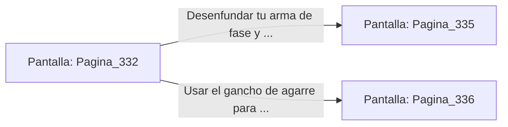

# 📺 Nodo Pantalla: `Pagina_332`

[[Index|⬅️ Índice]] | Fichero Origen: [[sample_eligejuego-code_capitulo_18_mpl|📄 sample/eligejuego-code/capitulo_18.mpl]]

**Narrativa y Encabezado:**
> PÁGINA 332: LA GALERÍA DE LAS ARMADURAS
> 
> Avanzas con cautela entre las hileras de armaduras metálicas que flanquean el pasillo. Aunque permanecen inmóviles sobre sus pedestales de piedra, los sensores de tu Brazal detectan una leve carga de energía residual en sus núcleos.
> 
> Al llegar a la mitad de la galería, una reja de hierro cae a tus espaldas con un estruendo sordo, bloqueando el camino de retorno y activando los visores ópticos de dos de las armaduras.

## 📋 Desglose de Instrucciones de Opciones
### `OPCION "Desenfundar tu arma de fase y encarar a los dos guardianes" CON_ACCION TRANSICIONAR_A Pagina_335`
* **Instrucción:** `OPCION` *(Manual: Mapea una entrada o botón interactivo de usuario. Vincular una acción como la invocación de una función C1, un método C2 o una transición C3.)*
* **Efecto de Control:** Dispara `TRANSICIONAR_A` hacia [[Pantalla_Pagina_335|📺 Pagina_335]]
### `OPCION "Usar el gancho de agarre para subir a las vigas del techo y escapar" CON_ACCION TRANSICIONAR_A Pagina_336`
* **Instrucción:** `OPCION` *(Manual: Mapea una entrada o botón interactivo de usuario. Vincular una acción como la invocación de una función C1, un método C2 o una transición C3.)*
* **Efecto de Control:** Dispara `TRANSICIONAR_A` hacia [[Pantalla_Pagina_336|📺 Pagina_336]]

## 📊 Diagrama de Flujo e Interacción (Mermaid)

