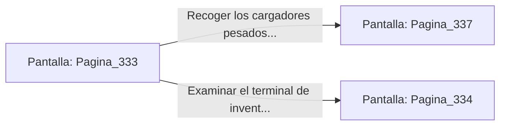

# 📺 Nodo Pantalla: `Pagina_333`

[[Index|⬅️ Índice]] | Fichero Origen: [[sample_eligejuego-code_capitulo_18_mpl|📄 sample/eligejuego-code/capitulo_18.mpl]]

**Narrativa y Encabezado:**
> PÁGINA 333: LOS DEPÓSITOS DE MUNICIÓN PESADA
> 
> Bajas peldaño a peldaño por la helada escalera de caracol hasta alcanzar la penumbra de los depósitos inferiores. Cajas de titanio reforzado marcadas con el sello de la Vieja Guardia se apilan en filas ordenadas bajo la bóveda de mampostería.
> 
> Entre los anaqueles descubres una caja blindada que permanece entreabierta, dejando al descubierto varios cargadores de pulso concusivo y un dispositivo de recarga rápida de escudos arcanos.
> 
> Tienes la oportunidad de reequipar tu arnés táctico con los cargadores pesados antes de continuar por el pasadizo secundario que conduce a los alojamientos de los oficiales.

## 📋 Desglose de Instrucciones de Opciones
### `OPCION "Recoger los cargadores pesados e ir a los alojamientos de oficiales" CON_ACCION TRANSICIONAR_A Pagina_337`
* **Instrucción:** `OPCION` *(Manual: Mapea una entrada o botón interactivo de usuario. Vincular una acción como la invocación de una función C1, un método C2 o una transición C3.)*
* **Efecto de Control:** Dispara `TRANSICIONAR_A` hacia [[Pantalla_Pagina_337|📺 Pagina_337]]
### `OPCION "Examinar el terminal de inventario del depósito antes de seguir" CON_ACCION TRANSICIONAR_A Pagina_334`
* **Instrucción:** `OPCION` *(Manual: Mapea una entrada o botón interactivo de usuario. Vincular una acción como la invocación de una función C1, un método C2 o una transición C3.)*
* **Efecto de Control:** Dispara `TRANSICIONAR_A` hacia [[Pantalla_Pagina_334|📺 Pagina_334]]

## 📊 Diagrama de Flujo e Interacción (Mermaid)

