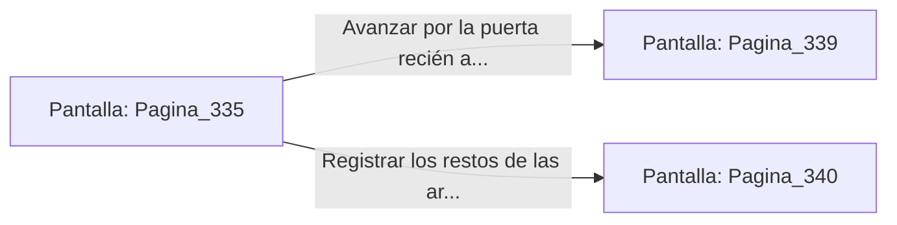

# 📺 Nodo Pantalla: `Pagina_335`

[[Index|⬅️ Índice]] | Fichero Origen: [[sample_eligejuego-code_capitulo_18_mpl|📄 sample/eligejuego-code/capitulo_18.mpl]]

**Narrativa y Encabezado:**
> PÁGINA 335: COMBATE EN LA GALERÍA DE ARMADURAS
> 
> Las dos armaduras ceremoniales bajan de sus pedestales esgrimiendo alabardas de luz estelar. Te desplazas lateralmente sobre las losas de mármol, esquivando el primer barrido de energía que quiebra la mampostería a tus espaldas.
> 
> Gracias a los reflejos potenciados por tu Brazal, identificas el punto débil en los servomotores de su cuello. Con dos disparos precisos de tu arma de fase, desarticulas los núcleos de control de ambas unidades, haciéndolas desplomarse sobre el suelo.
> 
> Con la amenaza neutralizada, la reja del fondo se levanta automáticamente, abriendo paso hacia los Aposentos del Gran Comandante.

## 📋 Desglose de Instrucciones de Opciones
### `OPCION "Avanzar por la puerta recién abierta a los Aposentos del Comandante" CON_ACCION TRANSICIONAR_A Pagina_339`
* **Instrucción:** `OPCION` *(Manual: Mapea una entrada o botón interactivo de usuario. Vincular una acción como la invocación de una función C1, un método C2 o una transición C3.)*
* **Efecto de Control:** Dispara `TRANSICIONAR_A` hacia [[Pantalla_Pagina_339|📺 Pagina_339]]
### `OPCION "Registrar los restos de las armaduras en busca de células de energía" CON_ACCION TRANSICIONAR_A Pagina_340`
* **Instrucción:** `OPCION` *(Manual: Mapea una entrada o botón interactivo de usuario. Vincular una acción como la invocación de una función C1, un método C2 o una transición C3.)*
* **Efecto de Control:** Dispara `TRANSICIONAR_A` hacia [[Pantalla_Pagina_340|📺 Pagina_340]]

## 📊 Diagrama de Flujo e Interacción (Mermaid)

