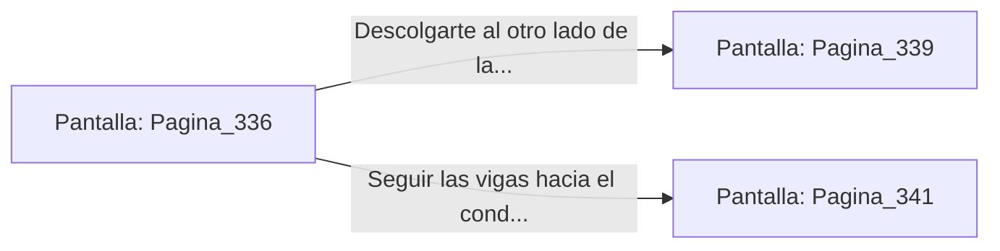

# 📺 Nodo Pantalla: `Pagina_336`

[[Index|⬅️ Índice]] | Fichero Origen: [[sample_eligejuego-code_capitulo_18_mpl|📄 sample/eligejuego-code/capitulo_18.mpl]]

**Narrativa y Encabezado:**
> PÁGINA 336: ESCAPE HACIA LAS VIGAS DEL TECHO
> 
> Disparas el gancho de agarre hacia los arcos de soporte del techo y te elevas justo cuando las alabardas de los guardianes impactan contra el suelo. Te encaramas con agilidad a las vigas de madera de ébano.
> 
> Avanzas mano sobre mano por la estructura del techo, dejando atrás a las dos armaduras desorientadas en la galería inferior.

## 📋 Desglose de Instrucciones de Opciones
### `OPCION "Descolgarte al otro lado de la reja directamente a la antesala privada" CON_ACCION TRANSICIONAR_A Pagina_339`
* **Instrucción:** `OPCION` *(Manual: Mapea una entrada o botón interactivo de usuario. Vincular una acción como la invocación de una función C1, un método C2 o una transición C3.)*
* **Efecto de Control:** Dispara `TRANSICIONAR_A` hacia [[Pantalla_Pagina_339|📺 Pagina_339]]
### `OPCION "Seguir las vigas hacia el conducto de ventilación del palacio" CON_ACCION TRANSICIONAR_A Pagina_341`
* **Instrucción:** `OPCION` *(Manual: Mapea una entrada o botón interactivo de usuario. Vincular una acción como la invocación de una función C1, un método C2 o una transición C3.)*
* **Efecto de Control:** Dispara `TRANSICIONAR_A` hacia [[Pantalla_Pagina_341|📺 Pagina_341]]

## 📊 Diagrama de Flujo e Interacción (Mermaid)

