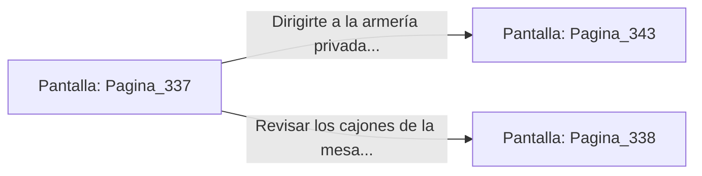

# 📺 Nodo Pantalla: `Pagina_337`

[[Index|⬅️ Índice]] | Fichero Origen: [[sample_eligejuego-code_capitulo_18_mpl|📄 sample/eligejuego-code/capitulo_18.mpl]]

**Narrativa y Encabezado:**
> PÁGINA 337: LOS ALOJAMIENTOS DE LOS OFICIALES
> 
> Te internas en el pasadizo secundario y alcanzas los alojamientos de la oficialidad del Bastión Superior. La estancia está desierta, pero sobre una mesa de caoba descansan mapas tácticos de las 600 Cámaras y un frasco de suero médico.
> 
> En la pared del fondo, un panel holográfico despliega el estado de las patrullas del sector y revela la combinación de la cerradura de tres frecuencias de la armería privada.
> 
> Guardas la combinación en la memoria de tu Brazal y repones tus reservas de salud con el suero antes de continuar tu marcha.

## 📋 Desglose de Instrucciones de Opciones
### `OPCION "Dirigirte a la armería privada con la combinación obtenida" CON_ACCION TRANSICIONAR_A Pagina_343`
* **Instrucción:** `OPCION` *(Manual: Mapea una entrada o botón interactivo de usuario. Vincular una acción como la invocación de una función C1, un método C2 o una transición C3.)*
* **Efecto de Control:** Dispara `TRANSICIONAR_A` hacia [[Pantalla_Pagina_343|📺 Pagina_343]]
### `OPCION "Revisar los cajones de la mesa táctica en busca de llaves de acceso" CON_ACCION TRANSICIONAR_A Pagina_338`
* **Instrucción:** `OPCION` *(Manual: Mapea una entrada o botón interactivo de usuario. Vincular una acción como la invocación de una función C1, un método C2 o una transición C3.)*
* **Efecto de Control:** Dispara `TRANSICIONAR_A` hacia [[Pantalla_Pagina_338|📺 Pagina_338]]

## 📊 Diagrama de Flujo e Interacción (Mermaid)

