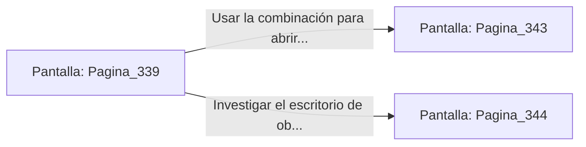

# 📺 Nodo Pantalla: `Pagina_339`

[[Index|⬅️ Índice]] | Fichero Origen: [[sample_eligejuego-code_capitulo_18_mpl|📄 sample/eligejuego-code/capitulo_18.mpl]]

**Narrativa y Encabezado:**
> PÁGINA 339: LOS APOSENTOS DEL GRAN COMANDANTE
> 
> Penetras en los amplios Aposentos del Gran Comandante. Tapices bordados con hilo de plata, estanterías repletas de tomos militares y armas antiguas enmarcadas en bronce decoran la sobria estancia.
> 
> En el centro de la sala, tras un imponente escritorio de obsidiana, se abre la puerta blindada que da acceso a la armería privada y a la terraza de la guardia.
> 
> Tienes la opción de usar la combinación obtenida para desbloquear la armería o investigar el escritorio de obsidiana en busca de planos adicionales.

## 📋 Desglose de Instrucciones de Opciones
### `OPCION "Usar la combinación para abrir la puerta de la armería privada" CON_ACCION TRANSICIONAR_A Pagina_343`
* **Instrucción:** `OPCION` *(Manual: Mapea una entrada o botón interactivo de usuario. Vincular una acción como la invocación de una función C1, un método C2 o una transición C3.)*
* **Efecto de Control:** Dispara `TRANSICIONAR_A` hacia [[Pantalla_Pagina_343|📺 Pagina_343]]
### `OPCION "Investigar el escritorio de obsidiana en busca de documentos" CON_ACCION TRANSICIONAR_A Pagina_344`
* **Instrucción:** `OPCION` *(Manual: Mapea una entrada o botón interactivo de usuario. Vincular una acción como la invocación de una función C1, un método C2 o una transición C3.)*
* **Efecto de Control:** Dispara `TRANSICIONAR_A` hacia [[Pantalla_Pagina_344|📺 Pagina_344]]

## 📊 Diagrama de Flujo e Interacción (Mermaid)

