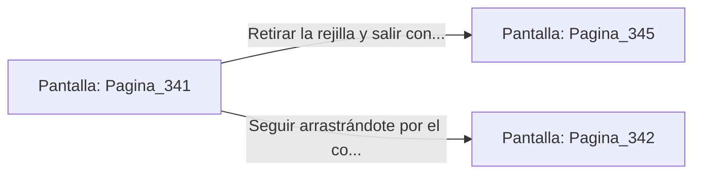

# 📺 Nodo Pantalla: `Pagina_341`

[[Index|⬅️ Índice]] | Fichero Origen: [[sample_eligejuego-code_capitulo_18_mpl|📄 sample/eligejuego-code/capitulo_18.mpl]]

**Narrativa y Encabezado:**
> PÁGINA 341: EL CONDUCTO DE VENTILACIÓN DEL PALACIO
> 
> Te te introduces en el estrecho conducto metálico de ventilación. El aire frío circula con fuerza desde las capas exteriores, arrastrando un leve olor a ozono y nieve molida.
> 
> Avanzas arrastrándote durante varios minutos hasta alcanzar una rejilla que da directamente a la terraza superior del palacio, donde patrullan los escuadrones de élite.
> 
> Puedes retirar la rejilla en silencio para salir a la terraza o seguir arrastrándote hacia los laboratorios superiores.

## 📋 Desglose de Instrucciones de Opciones
### `OPCION "Retirar la rejilla y salir con cautela a la terraza superior" CON_ACCION TRANSICIONAR_A Pagina_345`
* **Instrucción:** `OPCION` *(Manual: Mapea una entrada o botón interactivo de usuario. Vincular una acción como la invocación de una función C1, un método C2 o una transición C3.)*
* **Efecto de Control:** Dispara `TRANSICIONAR_A` hacia [[Pantalla_Pagina_345|📺 Pagina_345]]
### `OPCION "Seguir arrastrándote por el conducto hacia los laboratorios" CON_ACCION TRANSICIONAR_A Pagina_342`
* **Instrucción:** `OPCION` *(Manual: Mapea una entrada o botón interactivo de usuario. Vincular una acción como la invocación de una función C1, un método C2 o una transición C3.)*
* **Efecto de Control:** Dispara `TRANSICIONAR_A` hacia [[Pantalla_Pagina_342|📺 Pagina_342]]

## 📊 Diagrama de Flujo e Interacción (Mermaid)

