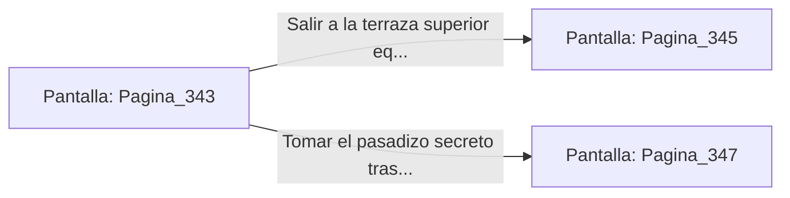

# 📺 Nodo Pantalla: `Pagina_343`

[[Index|⬅️ Índice]] | Fichero Origen: [[sample_eligejuego-code_capitulo_18_mpl|📄 sample/eligejuego-code/capitulo_18.mpl]]

**Narrativa y Encabezado:**
> PÁGINA 343: LA ARMERÍA PRIVADA DEL COMANDANTE
> 
> Marcas la secuencia de tres frecuencias en el dial de la puerta blindada. Los cerrojos de titanio se retraen con una serie de chasquidos pesados y las hojas acorazadas se desplizan, revelando un arsenal excepcional.
> 
> En el interior descansan rifles de pulso de fase de última generación, un escudo reflector de inducción y dos viales de plasma regenerativo purificado.
> 
> Te reequipas con el armamento avanzado y consumes uno de los viales para curar las contusiones sufridas en los combates previos.

## 📋 Desglose de Instrucciones de Opciones
### `OPCION "Salir a la terraza superior equipado con el armamento avanzado" CON_ACCION TRANSICIONAR_A Pagina_345`
* **Instrucción:** `OPCION` *(Manual: Mapea una entrada o botón interactivo de usuario. Vincular una acción como la invocación de una función C1, un método C2 o una transición C3.)*
* **Efecto de Control:** Dispara `TRANSICIONAR_A` hacia [[Pantalla_Pagina_345|📺 Pagina_345]]
### `OPCION "Tomar el pasadizo secreto tras los bastidores del arsenal" CON_ACCION TRANSICIONAR_A Pagina_347`
* **Instrucción:** `OPCION` *(Manual: Mapea una entrada o botón interactivo de usuario. Vincular una acción como la invocación de una función C1, un método C2 o una transición C3.)*
* **Efecto de Control:** Dispara `TRANSICIONAR_A` hacia [[Pantalla_Pagina_347|📺 Pagina_347]]

## 📊 Diagrama de Flujo e Interacción (Mermaid)

