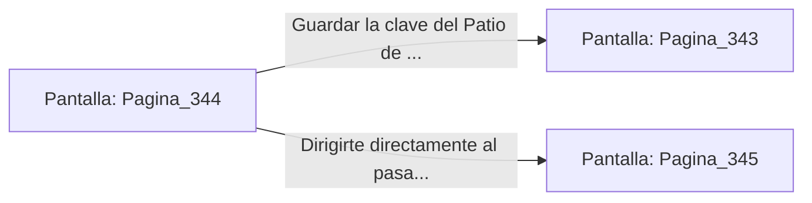

# 📺 Nodo Pantalla: `Pagina_344`

[[Index|⬅️ Índice]] | Fichero Origen: [[sample_eligejuego-code_capitulo_18_mpl|📄 sample/eligejuego-code/capitulo_18.mpl]]

**Narrativa y Encabezado:**
> PÁGINA 344: EL ESCRITORIO DE OBSIDIANA
> 
> Examinas la superficie del escritorio de obsidiana y presionas un resorte oculto bajo el tapete. Un compartimento secreto se abre revelando una orden firmada que detalla el despliegue de las defensas en las Cámaras 351 a 400.
> 
> El documento contiene además una clave de acceso directo para neutralizar las torretas del Patio de Honor.

## 📋 Desglose de Instrucciones de Opciones
### `OPCION "Guardar la clave del Patio de Honor e ingresar a la armería" CON_ACCION TRANSICIONAR_A Pagina_343`
* **Instrucción:** `OPCION` *(Manual: Mapea una entrada o botón interactivo de usuario. Vincular una acción como la invocación de una función C1, un método C2 o una transición C3.)*
* **Efecto de Control:** Dispara `TRANSICIONAR_A` hacia [[Pantalla_Pagina_343|📺 Pagina_343]]
### `OPCION "Dirigirte directamente al pasadizo de la terraza" CON_ACCION TRANSICIONAR_A Pagina_345`
* **Instrucción:** `OPCION` *(Manual: Mapea una entrada o botón interactivo de usuario. Vincular una acción como la invocación de una función C1, un método C2 o una transición C3.)*
* **Efecto de Control:** Dispara `TRANSICIONAR_A` hacia [[Pantalla_Pagina_345|📺 Pagina_345]]

## 📊 Diagrama de Flujo e Interacción (Mermaid)

