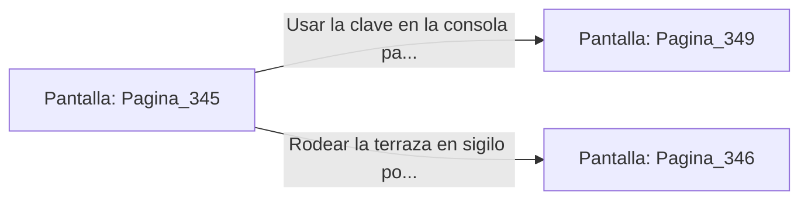

# 📺 Nodo Pantalla: `Pagina_345`

[[Index|⬅️ Índice]] | Fichero Origen: [[sample_eligejuego-code_capitulo_18_mpl|📄 sample/eligejuego-code/capitulo_18.mpl]]

**Narrativa y Encabezado:**
> PÁGINA 345: LA TERRAZA SUPERIOR DEL PALACIO
> 
> Sales a la inmensa terraza de mármol del Bastión Superior. La tormenta de éter azota las agujas de Aethelgard con fuerza, proyectando un espectáculo de luces violetas sobre el paisaje de la ciudadela subterránea.
> 
> Dos torretas automáticas custodian la puerta que da acceso al Patio de Honor, pero gracias a los datos obtenidos puedes intentar desarmarlas mediante la consola de la balaustrada.
> 
> Tienes la opción de usar tu clave en la consola para desarmar las torretas o usar el sigilo para rodear la terraza por los contrafuertes exteriores.

## 📋 Desglose de Instrucciones de Opciones
### `OPCION "Usar la clave en la consola para desactivar las torretas" CON_ACCION TRANSICIONAR_A Pagina_349`
* **Instrucción:** `OPCION` *(Manual: Mapea una entrada o botón interactivo de usuario. Vincular una acción como la invocación de una función C1, un método C2 o una transición C3.)*
* **Efecto de Control:** Dispara `TRANSICIONAR_A` hacia [[Pantalla_Pagina_349|📺 Pagina_349]]
### `OPCION "Rodear la terraza en sigilo por los contrafuertes exteriores" CON_ACCION TRANSICIONAR_A Pagina_346`
* **Instrucción:** `OPCION` *(Manual: Mapea una entrada o botón interactivo de usuario. Vincular una acción como la invocación de una función C1, un método C2 o una transición C3.)*
* **Efecto de Control:** Dispara `TRANSICIONAR_A` hacia [[Pantalla_Pagina_346|📺 Pagina_346]]

## 📊 Diagrama de Flujo e Interacción (Mermaid)

