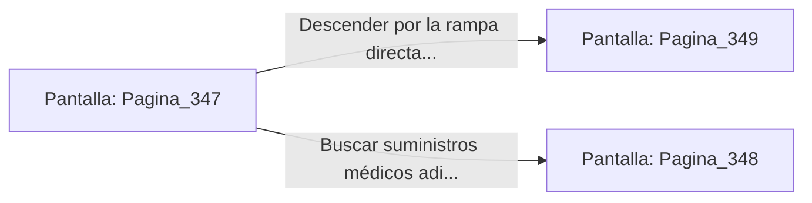

# 📺 Nodo Pantalla: `Pagina_347`

[[Index|⬅️ Índice]] | Fichero Origen: [[sample_eligejuego-code_capitulo_18_mpl|📄 sample/eligejuego-code/capitulo_18.mpl]]

**Narrativa y Encabezado:**
> PÁGINA 347: EL PASADIZO DE LOS BASTIDORES
> 
> Te introduces por la puerta secreta tras los bastidores del arsenal. El pasaje excavado en la roca viva desciende en suave pendiente hasta alcanzar la bóveda del Patio de Honor.
> 
> Desde un ventanal protegido por celosías observas el despliegue del contingente de guardia que custodia el acceso a la Aguja del Tiempo.
> 
> Con la información sobre sus patrones de patrulla memorizada, te dispones a ingresar al Patio de Honor.

## 📋 Desglose de Instrucciones de Opciones
### `OPCION "Descender por la rampa directa hacia el Patio de Honor" CON_ACCION TRANSICIONAR_A Pagina_349`
* **Instrucción:** `OPCION` *(Manual: Mapea una entrada o botón interactivo de usuario. Vincular una acción como la invocación de una función C1, un método C2 o una transición C3.)*
* **Efecto de Control:** Dispara `TRANSICIONAR_A` hacia [[Pantalla_Pagina_349|📺 Pagina_349]]
### `OPCION "Buscar suministros médicos adicionales en las hornacinas del pasaje" CON_ACCION TRANSICIONAR_A Pagina_348`
* **Instrucción:** `OPCION` *(Manual: Mapea una entrada o botón interactivo de usuario. Vincular una acción como la invocación de una función C1, un método C2 o una transición C3.)*
* **Efecto de Control:** Dispara `TRANSICIONAR_A` hacia [[Pantalla_Pagina_348|📺 Pagina_348]]

## 📊 Diagrama de Flujo e Interacción (Mermaid)

