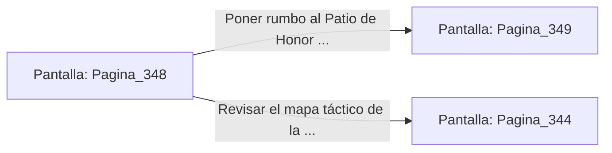

# 📺 Nodo Pantalla: `Pagina_348`

[[Index|⬅️ Índice]] | Fichero Origen: [[sample_eligejuego-code_capitulo_18_mpl|📄 sample/eligejuego-code/capitulo_18.mpl]]

**Narrativa y Encabezado:**
> PÁGINA 348: HORNACINAS DE SUMINISTROS
> 
> Revisas las hornacinas excavadas en las paredes del pasadizo y descubres un botiquín de la guardia con dos viales de suero concentrado y una granada de humo denso.
> 
> Guardas el equipo médico y la granada en tus cartucheras tácticas antes de continuar hacia el Patio de Honor.

## 📋 Desglose de Instrucciones de Opciones
### `OPCION "Poner rumbo al Patio de Honor con el equipo médico extra" CON_ACCION TRANSICIONAR_A Pagina_349`
* **Instrucción:** `OPCION` *(Manual: Mapea una entrada o botón interactivo de usuario. Vincular una acción como la invocación de una función C1, un método C2 o una transición C3.)*
* **Efecto de Control:** Dispara `TRANSICIONAR_A` hacia [[Pantalla_Pagina_349|📺 Pagina_349]]
### `OPCION "Revisar el mapa táctico de la Aguja del Tiempo" CON_ACCION TRANSICIONAR_A Pagina_344`
* **Instrucción:** `OPCION` *(Manual: Mapea una entrada o botón interactivo de usuario. Vincular una acción como la invocación de una función C1, un método C2 o una transición C3.)*
* **Efecto de Control:** Dispara `TRANSICIONAR_A` hacia [[Pantalla_Pagina_344|📺 Pagina_344]]

## 📊 Diagrama de Flujo e Interacción (Mermaid)

