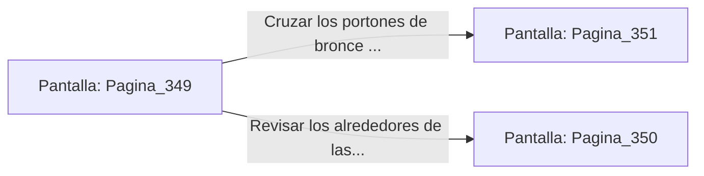

# 📺 Nodo Pantalla: `Pagina_349`

[[Index|⬅️ Índice]] | Fichero Origen: [[sample_eligejuego-code_capitulo_18_mpl|📄 sample/eligejuego-code/capitulo_18.mpl]]

**Narrativa y Encabezado:**
> PÁGINA 349: EL PATIO DE HONOR
> 
> Llegas al monumental Patio de Honor, el corazón fortificado que resguarda la base de la Aguja del Tiempo. Grandes columnas de basalto con inscripciones doradas flanquean la calzada principal.
> 
> Las torretas automáticas permanecen inactivas gracias a la clave introducida en la consola, permitiéndote cruzar la explanada con paso firme hacia el gran pórtico de acceso a la Aguja.
> 
> Te detienes un instante frente a los portones de bronce para verificar tu equipo antes de adentrarte en el Capítulo 19.

## 📋 Desglose de Instrucciones de Opciones
### `OPCION "Cruzar los portones de bronce e ingresar a la Aguja del Tiempo" CON_ACCION TRANSICIONAR_A Pagina_351`
* **Instrucción:** `OPCION` *(Manual: Mapea una entrada o botón interactivo de usuario. Vincular una acción como la invocación de una función C1, un método C2 o una transición C3.)*
* **Efecto de Control:** Dispara `TRANSICIONAR_A` hacia [[Pantalla_Pagina_351|📺 Pagina_351]]
### `OPCION "Revisar los alrededores de las columnas en busca de trampas" CON_ACCION TRANSICIONAR_A Pagina_350`
* **Instrucción:** `OPCION` *(Manual: Mapea una entrada o botón interactivo de usuario. Vincular una acción como la invocación de una función C1, un método C2 o una transición C3.)*
* **Efecto de Control:** Dispara `TRANSICIONAR_A` hacia [[Pantalla_Pagina_350|📺 Pagina_350]]

## 📊 Diagrama de Flujo e Interacción (Mermaid)

