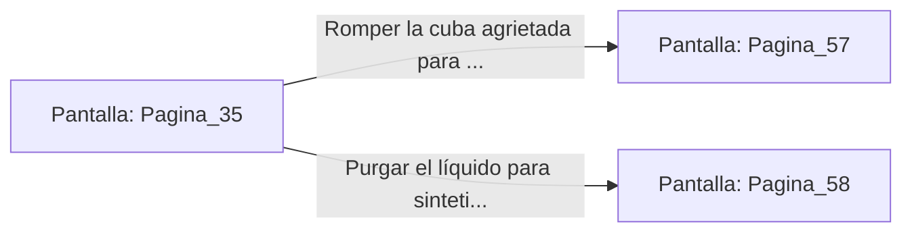

# 📺 Nodo Pantalla: `Pagina_35`

[[Index|⬅️ Índice]] | Fichero Origen: [[sample_eligejuego-code_capitulo_03_mpl|📄 sample/eligejuego-code/capitulo_03.mpl]]

**Narrativa y Encabezado:**
> PÁGINA 35: CUBAS DE CULTIVO SINTÉTICO
> 
> Te adentras entre gigantescas columnas de cristal llenas de un fluido verde viscoso. En su interior flotan organismos biomecánicos en gestación, creados por los alquimistas de Malakor para nutrir su ejército de espectros.
> 
> Una de las cubas muestra fisuras en su estructura y su indicador de presión parpadea en rojo. Si logras romper el cristal por completo, podrías provocar una reacción en cadena que destruya todo el laboratorio sintético.
> 
> Por otro lado, una consola lateral permite purgar el líquido de cultivo limpiamente para extraer una muestra de plasma curativo.

## 📋 Desglose de Instrucciones de Opciones
### `OPCION "Romper la cuba agrietada para destruir el laboratorio" CON_ACCION TRANSICIONAR_A Pagina_57`
* **Instrucción:** `OPCION` *(Manual: Mapea una entrada o botón interactivo de usuario. Vincular una acción como la invocación de una función C1, un método C2 o una transición C3.)*
* **Efecto de Control:** Dispara `TRANSICIONAR_A` hacia [[Pantalla_Pagina_57|📺 Pagina_57]]
### `OPCION "Purgar el líquido para sintetizar una dosis de plasma curativo" CON_ACCION TRANSICIONAR_A Pagina_58`
* **Instrucción:** `OPCION` *(Manual: Mapea una entrada o botón interactivo de usuario. Vincular una acción como la invocación de una función C1, un método C2 o una transición C3.)*
* **Efecto de Control:** Dispara `TRANSICIONAR_A` hacia [[Pantalla_Pagina_58|📺 Pagina_58]]

## 📊 Diagrama de Flujo e Interacción (Mermaid)

