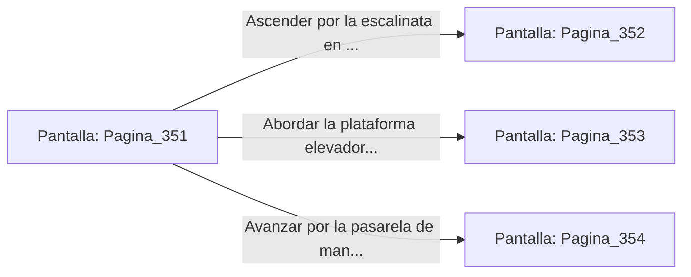

# 📺 Nodo Pantalla: `Pagina_351`

[[Index|⬅️ Índice]] | Fichero Origen: [[sample_eligejuego-code_capitulo_19_mpl|📄 sample/eligejuego-code/capitulo_19.mpl]]

**Narrativa y Encabezado:**
> PÁGINA 351: EL PÓRTICO DE LA AGUJA DEL TIEMPO
> 
> Cruzas el pórtico de bronce y pones un pie dentro de la estructura vertical de la Aguja del Tiempo. El espacio interior desafía las leyes de la física conocidas: gigantescos engranajes de bronce y titanio giran en el aire sin soporte visible, impulsados por haces de luz cian que conectan la base con el ápice del complejo.
> 
> Tu Brazal de Convergencia reacciona de inmediato, mostrando una fluctuación violenta en los sensores de la línea temporal. En este sector, las barreras de fase se entrelazan con residuos de memorias mnemónicas, proyectando ilusiones de batallas pasadas a lo largo de los pasillos de subida.
> 
> Frente a ti se abren tres vías de ascenso: una escalinata en espiral que bordear la pared exterior de la aguja, una plataforma elevadora de levitación magnética y una pasarela de mantenimiento de red.

## 📋 Desglose de Instrucciones de Opciones
### `OPCION "Ascender por la escalinata en espiral adosada a la pared exterior" CON_ACCION TRANSICIONAR_A Pagina_352`
* **Instrucción:** `OPCION` *(Manual: Mapea una entrada o botón interactivo de usuario. Vincular una acción como la invocación de una función C1, un método C2 o una transición C3.)*
* **Efecto de Control:** Dispara `TRANSICIONAR_A` hacia [[Pantalla_Pagina_352|📺 Pagina_352]]
### `OPCION "Abordar la plataforma elevadora de levitación magnética" CON_ACCION TRANSICIONAR_A Pagina_353`
* **Instrucción:** `OPCION` *(Manual: Mapea una entrada o botón interactivo de usuario. Vincular una acción como la invocación de una función C1, un método C2 o una transición C3.)*
* **Efecto de Control:** Dispara `TRANSICIONAR_A` hacia [[Pantalla_Pagina_353|📺 Pagina_353]]
### `OPCION "Avanzar por la pasarela de mantenimiento de la red" CON_ACCION TRANSICIONAR_A Pagina_354`
* **Instrucción:** `OPCION` *(Manual: Mapea una entrada o botón interactivo de usuario. Vincular una acción como la invocación de una función C1, un método C2 o una transición C3.)*
* **Efecto de Control:** Dispara `TRANSICIONAR_A` hacia [[Pantalla_Pagina_354|📺 Pagina_354]]

## 📊 Diagrama de Flujo e Interacción (Mermaid)

