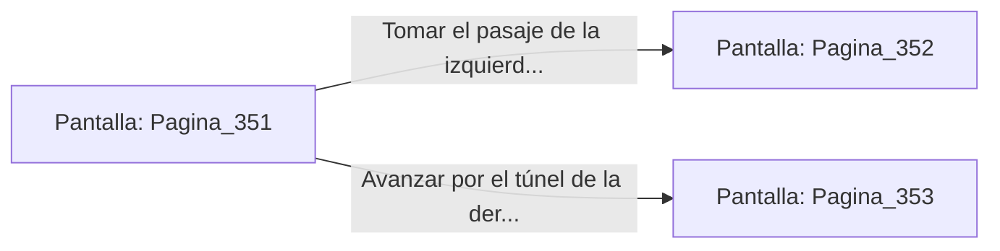

# 📺 Nodo Pantalla: `Pagina_351`

[[Index|⬅️ Índice]] | Fichero Origen: [[sample_eligejuego-code_capitulo_06_santuario_olvidado_mpl|📄 sample/eligejuego-code/capitulo_06_santuario_olvidado.mpl]]

**Narrativa y Encabezado:**
> Página 351: El Santuario Olvidado
> 
> Estatuas de reyes olvidados con los ojos tapados custodian tomos enmohecidos y altares rúnicos. Te encuentras ante una encrucijada en la penumbra de la mazmorra. Debes tomar una decisión.

## 📋 Desglose de Instrucciones de Opciones
### `OPCION "Tomar el pasaje de la izquierda (Página 352)" CON_ACCION TRANSICIONAR_A Pagina_352`
* **Instrucción:** `OPCION` *(Manual: Mapea una entrada o botón interactivo de usuario. Vincular una acción como la invocación de una función C1, un método C2 o una transición C3.)*
* **Efecto de Control:** Dispara `TRANSICIONAR_A` hacia [[Pantalla_Pagina_352|📺 Pagina_352]]
### `OPCION "Avanzar por el túnel de la derecha (Página 353)" CON_ACCION TRANSICIONAR_A Pagina_353`
* **Instrucción:** `OPCION` *(Manual: Mapea una entrada o botón interactivo de usuario. Vincular una acción como la invocación de una función C1, un método C2 o una transición C3.)*
* **Efecto de Control:** Dispara `TRANSICIONAR_A` hacia [[Pantalla_Pagina_353|📺 Pagina_353]]

## 📊 Diagrama de Flujo e Interacción (Mermaid)

