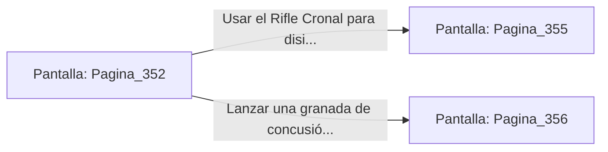

# 📺 Nodo Pantalla: `Pagina_352`

[[Index|⬅️ Índice]] | Fichero Origen: [[sample_eligejuego-code_capitulo_19_mpl|📄 sample/eligejuego-code/capitulo_19.mpl]]

**Narrativa y Encabezado:**
> PÁGINA 352: LA ESCALINATA EXTERIOR DE LA AGUJA
> 
> Asciendes a paso firme por los peldaños de granito pulido mientras el viento del abismo ruge a través de los ventanales sin cristal. A cada metro que ganas de altura, la vista de la ciudadela subterránea sumida en la penumbra se vuelve más impresionante.
> 
> A mitad de camino, una brecha temporal proyecta un espectro Guardián del Tiempo que alza su lanza de plasma bloqueando la subiría.

## 📋 Desglose de Instrucciones de Opciones
### `OPCION "Usar el Rifle Cronal para disipar la proyección del espectro" CON_ACCION TRANSICIONAR_A Pagina_355`
* **Instrucción:** `OPCION` *(Manual: Mapea una entrada o botón interactivo de usuario. Vincular una acción como la invocación de una función C1, un método C2 o una transición C3.)*
* **Efecto de Control:** Dispara `TRANSICIONAR_A` hacia [[Pantalla_Pagina_355|📺 Pagina_355]]
### `OPCION "Lanzar una granada de concusión contra la base de la proyección" CON_ACCION TRANSICIONAR_A Pagina_356`
* **Instrucción:** `OPCION` *(Manual: Mapea una entrada o botón interactivo de usuario. Vincular una acción como la invocación de una función C1, un método C2 o una transición C3.)*
* **Efecto de Control:** Dispara `TRANSICIONAR_A` hacia [[Pantalla_Pagina_356|📺 Pagina_356]]

## 📊 Diagrama de Flujo e Interacción (Mermaid)

