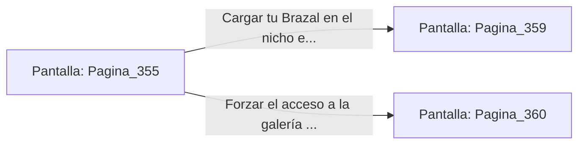

# 📺 Nodo Pantalla: `Pagina_355`

[[Index|⬅️ Índice]] | Fichero Origen: [[sample_eligejuego-code_capitulo_19_mpl|📄 sample/eligejuego-code/capitulo_19.mpl]]

**Narrativa y Encabezado:**
> PÁGINA 355: DISIPACIÓN DEL ESPECTRO
> 
> Alineas la mira de tu Rifle Cronal y disparas una ráfaga de aceleración contra el centro de la ilusión. Los proyectiles interrumpen la frecuencia de la proyección, haciendo que el espectro Guardián se disipe en una densa nube de chispas cian.
> 
> Con la escalinata despejada, continúas el ascenso hasta alcanzar el descansillo del Nivel Medio, donde una puerta de titanio rúnica custodia la entrada al Laboratorio de Crono-Análisis.
> 
> Junto al marco de la puerta encuentras un nicho de recarga que permite restaurar las reservas energéticas de tu Brazal antes de cruzar.

## 📋 Desglose de Instrucciones de Opciones
### `OPCION "Cargar tu Brazal en el nicho e ingresar al Laboratorio" CON_ACCION TRANSICIONAR_A Pagina_359`
* **Instrucción:** `OPCION` *(Manual: Mapea una entrada o botón interactivo de usuario. Vincular una acción como la invocación de una función C1, un método C2 o una transición C3.)*
* **Efecto de Control:** Dispara `TRANSICIONAR_A` hacia [[Pantalla_Pagina_359|📺 Pagina_359]]
### `OPCION "Forzar el acceso a la galería lateral de mantenimiento" CON_ACCION TRANSICIONAR_A Pagina_360`
* **Instrucción:** `OPCION` *(Manual: Mapea una entrada o botón interactivo de usuario. Vincular una acción como la invocación de una función C1, un método C2 o una transición C3.)*
* **Efecto de Control:** Dispara `TRANSICIONAR_A` hacia [[Pantalla_Pagina_360|📺 Pagina_360]]

## 📊 Diagrama de Flujo e Interacción (Mermaid)

