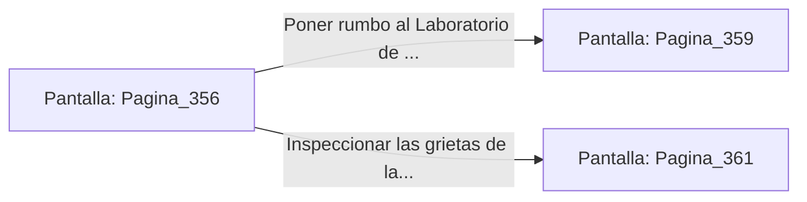

# 📺 Nodo Pantalla: `Pagina_356`

[[Index|⬅️ Índice]] | Fichero Origen: [[sample_eligejuego-code_capitulo_19_mpl|📄 sample/eligejuego-code/capitulo_19.mpl]]

**Narrativa y Encabezado:**
> PÁGINA 356: EXPLOSIÓN EN EL DESCANSILLO
> 
> Lanzas la granada de concusión contra la base de la proyección. La onda expansiva destruye la manifestación de plasma, pero agrieta la mampostería de los peldaños exteriores.
> 
> Saltas sobre la sección fracturada justo a tiempo y alcanzas el descansillo superior de la aguja.

## 📋 Desglose de Instrucciones de Opciones
### `OPCION "Poner rumbo al Laboratorio de Crono-Análisis" CON_ACCION TRANSICIONAR_A Pagina_359`
* **Instrucción:** `OPCION` *(Manual: Mapea una entrada o botón interactivo de usuario. Vincular una acción como la invocación de una función C1, un método C2 o una transición C3.)*
* **Efecto de Control:** Dispara `TRANSICIONAR_A` hacia [[Pantalla_Pagina_359|📺 Pagina_359]]
### `OPCION "Inspeccionar las grietas de la piedra en busca de objetos" CON_ACCION TRANSICIONAR_A Pagina_361`
* **Instrucción:** `OPCION` *(Manual: Mapea una entrada o botón interactivo de usuario. Vincular una acción como la invocación de una función C1, un método C2 o una transición C3.)*
* **Efecto de Control:** Dispara `TRANSICIONAR_A` hacia [[Pantalla_Pagina_361|📺 Pagina_361]]

## 📊 Diagrama de Flujo e Interacción (Mermaid)

