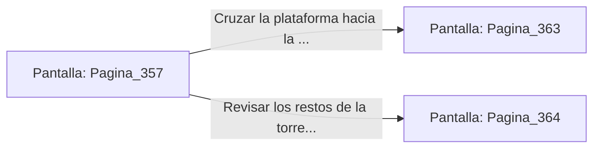

# 📺 Nodo Pantalla: `Pagina_357`

[[Index|⬅️ Índice]] | Fichero Origen: [[sample_eligejuego-code_capitulo_19_mpl|📄 sample/eligejuego-code/capitulo_19.mpl]]

**Narrativa y Encabezado:**
> PÁGINA 357: REFLEJO DE LA TORRETA DE FASE
> 
> Plantas firme tus botas sobre la plataforma y despliegas tu Escudo Deflector en el segundo exacto en que la torreta dispara su haz de radiación. El campo cuántico absorbe el impacto y devuelve la descarga con el doble de intensidad.
> 
> El haz reflejado impacta directamente contra el soporte de la torreta, destruyéndola en una explosión de piezas metálicas y permitiendo que la plataforma continúe su ascenso sin trabas.
> 
> El elevador frena suavemente al alcanzar la plataforma superior del Nivel Treinta, abriendo sus puertas hacia la Cámara del Cronoclave Maestro.

## 📋 Desglose de Instrucciones de Opciones
### `OPCION "Cruzar la plataforma hacia la Cámara del Cronoclave Maestro" CON_ACCION TRANSICIONAR_A Pagina_363`
* **Instrucción:** `OPCION` *(Manual: Mapea una entrada o botón interactivo de usuario. Vincular una acción como la invocación de una función C1, un método C2 o una transición C3.)*
* **Efecto de Control:** Dispara `TRANSICIONAR_A` hacia [[Pantalla_Pagina_363|📺 Pagina_363]]
### `OPCION "Revisar los restos de la torreta destruida en la cornisa" CON_ACCION TRANSICIONAR_A Pagina_364`
* **Instrucción:** `OPCION` *(Manual: Mapea una entrada o botón interactivo de usuario. Vincular una acción como la invocación de una función C1, un método C2 o una transición C3.)*
* **Efecto de Control:** Dispara `TRANSICIONAR_A` hacia [[Pantalla_Pagina_364|📺 Pagina_364]]

## 📊 Diagrama de Flujo e Interacción (Mermaid)

