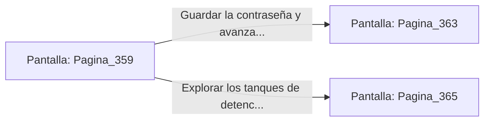

# 📺 Nodo Pantalla: `Pagina_359`

[[Index|⬅️ Índice]] | Fichero Origen: [[sample_eligejuego-code_capitulo_19_mpl|📄 sample/eligejuego-code/capitulo_19.mpl]]

**Narrativa y Encabezado:**
> PÁGINA 359: EL LABORATORIO DE CRONO-ANÁLISIS
> 
> Ingresas al Laboratorio de Crono-Análisis con las baterías del Brazal al máximo. Inmensos tanques de cristal que albergan fluidos de detención temporal dominan el recinto, mientras mesas de trabajo repletas de lentes y escáneres se alinean en las paredes.
> 
> En la pantalla central se proyecta el estado operativo del Cronoclave Maestro y la contraseña mnemónica de emergencia que permite omitir las defensas del Nivel Treinta.
> 
> Decides guardar la contraseña mnemónica en tu memoria y recoger dos viales de plasma curativo de los anaqueles antes de avanzar.

## 📋 Desglose de Instrucciones de Opciones
### `OPCION "Guardar la contraseña y avanzar hacia la Cámara del Cronoclave" CON_ACCION TRANSICIONAR_A Pagina_363`
* **Instrucción:** `OPCION` *(Manual: Mapea una entrada o botón interactivo de usuario. Vincular una acción como la invocación de una función C1, un método C2 o una transición C3.)*
* **Efecto de Control:** Dispara `TRANSICIONAR_A` hacia [[Pantalla_Pagina_363|📺 Pagina_363]]
### `OPCION "Explorar los tanques de detención temporal en busca de más muestras" CON_ACCION TRANSICIONAR_A Pagina_365`
* **Instrucción:** `OPCION` *(Manual: Mapea una entrada o botón interactivo de usuario. Vincular una acción como la invocación de una función C1, un método C2 o una transición C3.)*
* **Efecto de Control:** Dispara `TRANSICIONAR_A` hacia [[Pantalla_Pagina_365|📺 Pagina_365]]

## 📊 Diagrama de Flujo e Interacción (Mermaid)

