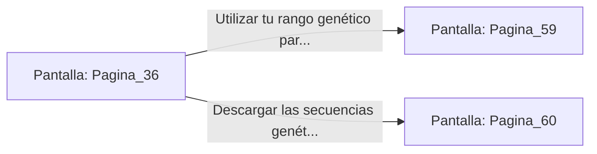

# 📺 Nodo Pantalla: `Pagina_36`

[[Index|⬅️ Índice]] | Fichero Origen: [[sample_eligejuego-code_capitulo_03_mpl|📄 sample/eligejuego-code/capitulo_03.mpl]]

**Narrativa y Encabezado:**
> PÁGINA 36: ANÁLISIS GENÉTICO
> 
> Accedes a la terminal biológica y escaneas tu propio código genético con el sensor del Brazal. Las pantallas muestran con claridad un hallazgo asombroso: llevas en tu sangre la firma biológica de los Antiguos Reyes de Aethelgard.
> 
> Este descubrimiento desbloquea privilegios de administración de alto nivel en las instalaciones de la ciudadela.

## 📋 Desglose de Instrucciones de Opciones
### `OPCION "Utilizar tu rango genético para desbloquear la armería secreta" CON_ACCION TRANSICIONAR_A Pagina_59`
* **Instrucción:** `OPCION` *(Manual: Mapea una entrada o botón interactivo de usuario. Vincular una acción como la invocación de una función C1, un método C2 o una transición C3.)*
* **Efecto de Control:** Dispara `TRANSICIONAR_A` hacia [[Pantalla_Pagina_59|📺 Pagina_59]]
### `OPCION "Descargar las secuencias genéticas para potenciar tus habilidades" CON_ACCION TRANSICIONAR_A Pagina_60`
* **Instrucción:** `OPCION` *(Manual: Mapea una entrada o botón interactivo de usuario. Vincular una acción como la invocación de una función C1, un método C2 o una transición C3.)*
* **Efecto de Control:** Dispara `TRANSICIONAR_A` hacia [[Pantalla_Pagina_60|📺 Pagina_60]]

## 📊 Diagrama de Flujo e Interacción (Mermaid)

