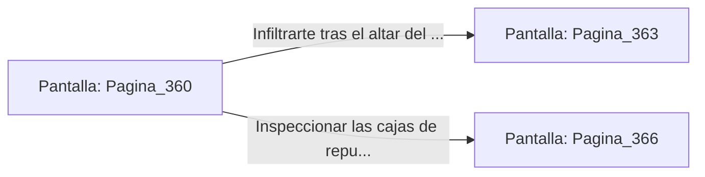

# 📺 Nodo Pantalla: `Pagina_360`

[[Index|⬅️ Índice]] | Fichero Origen: [[sample_eligejuego-code_capitulo_19_mpl|📄 sample/eligejuego-code/capitulo_19.mpl]]

**Narrativa y Encabezado:**
> PÁGINA 360: LA GALERÍA DE MANTENIMIENTO LATERAL
> 
> Forzaste la cerradura rúnica de la galería lateral de mantenimiento. El angosto túnel está revestido de tuberías de éter frío que vibran al ritmo de la maquinaria de la aguja.
> 
> Avanzas a paso ligero hasta encontrar una rejilla de salida que desemboca directamente tras el altar del Cronoclave Maestro.

## 📋 Desglose de Instrucciones de Opciones
### `OPCION "Infiltrarte tras el altar del Cronoclave Maestro por la rejilla" CON_ACCION TRANSICIONAR_A Pagina_363`
* **Instrucción:** `OPCION` *(Manual: Mapea una entrada o botón interactivo de usuario. Vincular una acción como la invocación de una función C1, un método C2 o una transición C3.)*
* **Efecto de Control:** Dispara `TRANSICIONAR_A` hacia [[Pantalla_Pagina_363|📺 Pagina_363]]
### `OPCION "Inspeccionar las cajas de repuesto del túnel" CON_ACCION TRANSICIONAR_A Pagina_366`
* **Instrucción:** `OPCION` *(Manual: Mapea una entrada o botón interactivo de usuario. Vincular una acción como la invocación de una función C1, un método C2 o una transición C3.)*
* **Efecto de Control:** Dispara `TRANSICIONAR_A` hacia [[Pantalla_Pagina_366|📺 Pagina_366]]

## 📊 Diagrama de Flujo e Interacción (Mermaid)

