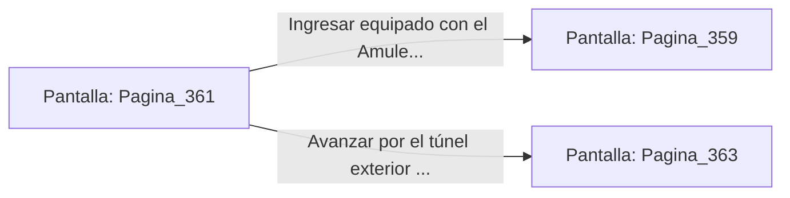

# 📺 Nodo Pantalla: `Pagina_361`

[[Index|⬅️ Índice]] | Fichero Origen: [[sample_eligejuego-code_capitulo_19_mpl|📄 sample/eligejuego-code/capitulo_19.mpl]]

**Narrativa y Encabezado:**
> PÁGINA 361: EL NICHO OCULTO DE LA ESCALINATA
> 
> Investigas las grietas provocadas por la explosión en la pared de la escalinata y descubres un nicho secreto cavado por los antiguos arquitectos de Aethelgard.
> 
> En su interior descansa un Amuleto de Refracción Cronal y una gema de carga de salud que restauran tus capacidades físicas y defensivas al instante.
> 
> Satisfecho con el hallazgo, te incorporas y reanudas el camino hacia la puerta del Laboratorio de Crono-Análisis.

## 📋 Desglose de Instrucciones de Opciones
### `OPCION "Ingresar equipado con el Amuleto al Laboratorio" CON_ACCION TRANSICIONAR_A Pagina_359`
* **Instrucción:** `OPCION` *(Manual: Mapea una entrada o botón interactivo de usuario. Vincular una acción como la invocación de una función C1, un método C2 o una transición C3.)*
* **Efecto de Control:** Dispara `TRANSICIONAR_A` hacia [[Pantalla_Pagina_359|📺 Pagina_359]]
### `OPCION "Avanzar por el túnel exterior hacia la Cámara Maestro" CON_ACCION TRANSICIONAR_A Pagina_363`
* **Instrucción:** `OPCION` *(Manual: Mapea una entrada o botón interactivo de usuario. Vincular una acción como la invocación de una función C1, un método C2 o una transición C3.)*
* **Efecto de Control:** Dispara `TRANSICIONAR_A` hacia [[Pantalla_Pagina_363|📺 Pagina_363]]

## 📊 Diagrama de Flujo e Interacción (Mermaid)

