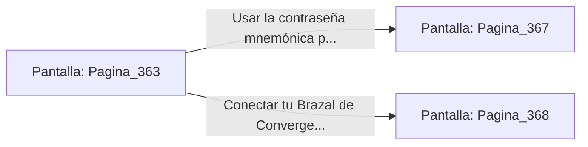

# 📺 Nodo Pantalla: `Pagina_363`

[[Index|⬅️ Índice]] | Fichero Origen: [[sample_eligejuego-code_capitulo_19_mpl|📄 sample/eligejuego-code/capitulo_19.mpl]]

**Narrativa y Encabezado:**
> PÁGINA 363: LA CÁMARA DEL CRONOCLAVE MAESTRO
> 
> Entras en la colosal Cámara del Cronoclave Maestro. En el centro del recinto flota un inmenso mecanismo en forma de reloj astrológico formado por tres anillos concéntricos de oro y titanio que giran impulsados por una columna de fuego azulino.
> 
> El artefacto regula el flujo espacio-temporal de todas las 600 Cámaras de la ciudadela. Un panel de control maestro situado frente al altar requiere introducir la clave mnemónica o la sincronización directa de tu Brazal.
> 
> Tienes la oportunidad de usar la contraseña mnemónica obtenida en el laboratorio para tomar el mando del Cronoclave o conectar tu Brazal directamente.

## 📋 Desglose de Instrucciones de Opciones
### `OPCION "Usar la contraseña mnemónica para tomar el mando del Cronoclave" CON_ACCION TRANSICIONAR_A Pagina_367`
* **Instrucción:** `OPCION` *(Manual: Mapea una entrada o botón interactivo de usuario. Vincular una acción como la invocación de una función C1, un método C2 o una transición C3.)*
* **Efecto de Control:** Dispara `TRANSICIONAR_A` hacia [[Pantalla_Pagina_367|📺 Pagina_367]]
### `OPCION "Conectar tu Brazal de Convergencia directamente al conmutador" CON_ACCION TRANSICIONAR_A Pagina_368`
* **Instrucción:** `OPCION` *(Manual: Mapea una entrada o botón interactivo de usuario. Vincular una acción como la invocación de una función C1, un método C2 o una transición C3.)*
* **Efecto de Control:** Dispara `TRANSICIONAR_A` hacia [[Pantalla_Pagina_368|📺 Pagina_368]]

## 📊 Diagrama de Flujo e Interacción (Mermaid)

