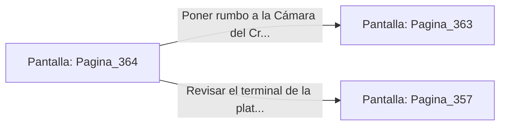

# 📺 Nodo Pantalla: `Pagina_364`

[[Index|⬅️ Índice]] | Fichero Origen: [[sample_eligejuego-code_capitulo_19_mpl|📄 sample/eligejuego-code/capitulo_19.mpl]]

**Narrativa y Encabezado:**
> PÁGINA 364: REGISTRO DE LA TORRETA
> 
> Examinas los restos de la torreta destruida en la cornisa. Entre las piezas carbonizadas recuperas un cristal de enfoque térmico y dos células de energía militar intactas.
> 
> Sincronizas los componentes con tu arnés antes de ingresar a la Cámara del Cronoclave.

## 📋 Desglose de Instrucciones de Opciones
### `OPCION "Poner rumbo a la Cámara del Cronoclave Maestro" CON_ACCION TRANSICIONAR_A Pagina_363`
* **Instrucción:** `OPCION` *(Manual: Mapea una entrada o botón interactivo de usuario. Vincular una acción como la invocación de una función C1, un método C2 o una transición C3.)*
* **Efecto de Control:** Dispara `TRANSICIONAR_A` hacia [[Pantalla_Pagina_363|📺 Pagina_363]]
### `OPCION "Revisar el terminal de la plataforma" CON_ACCION TRANSICIONAR_A Pagina_357`
* **Instrucción:** `OPCION` *(Manual: Mapea una entrada o botón interactivo de usuario. Vincular una acción como la invocación de una función C1, un método C2 o una transición C3.)*
* **Efecto de Control:** Dispara `TRANSICIONAR_A` hacia [[Pantalla_Pagina_357|📺 Pagina_357]]

## 📊 Diagrama de Flujo e Interacción (Mermaid)

