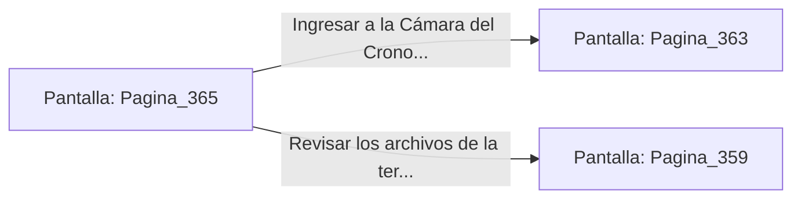

# 📺 Nodo Pantalla: `Pagina_365`

[[Index|⬅️ Índice]] | Fichero Origen: [[sample_eligejuego-code_capitulo_19_mpl|📄 sample/eligejuego-code/capitulo_19.mpl]]

**Narrativa y Encabezado:**
> PÁGINA 365: LOS TANQUES DE DETENCIÓN TEMPORAL
> 
> Examinas los tanques de cristal del laboratorio de análisis. En el interior de uno de los contenedores flota un artefacto antiguo: el Núcleo de Estabilidad Inversa, capaz de anular cualquier trampa cronal en combate.
> 
> Utilizas la herramienta de tu Brazal para drenar el fluido y extraer el artefacto de forma segura sin romper la contención de vacío.
> 
> Con el Núcleo de Estabilidad en tu poder, pones rumbo definitivo hacia la Cámara del Cronoclave Maestro.

## 📋 Desglose de Instrucciones de Opciones
### `OPCION "Ingresar a la Cámara del Cronoclave con el Núcleo de Estabilidad" CON_ACCION TRANSICIONAR_A Pagina_363`
* **Instrucción:** `OPCION` *(Manual: Mapea una entrada o botón interactivo de usuario. Vincular una acción como la invocación de una función C1, un método C2 o una transición C3.)*
* **Efecto de Control:** Dispara `TRANSICIONAR_A` hacia [[Pantalla_Pagina_363|📺 Pagina_363]]
### `OPCION "Revisar los archivos de la terminal central" CON_ACCION TRANSICIONAR_A Pagina_359`
* **Instrucción:** `OPCION` *(Manual: Mapea una entrada o botón interactivo de usuario. Vincular una acción como la invocación de una función C1, un método C2 o una transición C3.)*
* **Efecto de Control:** Dispara `TRANSICIONAR_A` hacia [[Pantalla_Pagina_359|📺 Pagina_359]]

## 📊 Diagrama de Flujo e Interacción (Mermaid)

