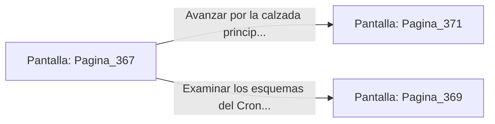

# 📺 Nodo Pantalla: `Pagina_367`

[[Index|⬅️ Índice]] | Fichero Origen: [[sample_eligejuego-code_capitulo_19_mpl|📄 sample/eligejuego-code/capitulo_19.mpl]]

**Narrativa y Encabezado:**
> PÁGINA 367: EL CONTROL DEL CRONOCLAVE
> 
> Tecles la contraseña mnemónica en el panel del altar. Los tres anillos concéntricos del Cronoclave Maestro reducen su velocidad de rotación hasta detenerse en una alineación perfecta, emitiendo una luz dorada y armónica.
> 
> La interfaz del altar confirma que los subsistemas de las Cámaras 351 a 390 han sido estabilizados y desbloqueados de cualquier protocolo de purga violenta.
> 
> Con el control de la aguja asegurado, se abre ante ti la calzada que conduce directamente a los Santuarios del Capítulo 20.

## 📋 Desglose de Instrucciones de Opciones
### `OPCION "Avanzar por la calzada principal hacia los Santuarios del Capítulo 20" CON_ACCION TRANSICIONAR_A Pagina_371`
* **Instrucción:** `OPCION` *(Manual: Mapea una entrada o botón interactivo de usuario. Vincular una acción como la invocación de una función C1, un método C2 o una transición C3.)*
* **Efecto de Control:** Dispara `TRANSICIONAR_A` hacia [[Pantalla_Pagina_371|📺 Pagina_371]]
### `OPCION "Examinar los esquemas del Cronoclave antes de marcharte" CON_ACCION TRANSICIONAR_A Pagina_369`
* **Instrucción:** `OPCION` *(Manual: Mapea una entrada o botón interactivo de usuario. Vincular una acción como la invocación de una función C1, un método C2 o una transición C3.)*
* **Efecto de Control:** Dispara `TRANSICIONAR_A` hacia [[Pantalla_Pagina_369|📺 Pagina_369]]

## 📊 Diagrama de Flujo e Interacción (Mermaid)

