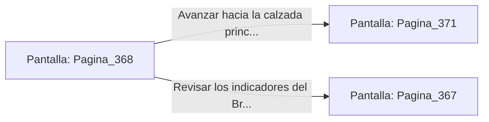

# 📺 Nodo Pantalla: `Pagina_368`

[[Index|⬅️ Índice]] | Fichero Origen: [[sample_eligejuego-code_capitulo_19_mpl|📄 sample/eligejuego-code/capitulo_19.mpl]]

**Narrativa y Encabezado:**
> PÁGINA 368: CONEXIÓN DIRECTA DEL BRAZAL
> 
> Conectas tu Brazal de Convergencia al conmutador central del Cronoclave. La energía del artefacto fluye a través de tus circuitos, sincronizando el dispositivo y estabilizando los anillos de la aguja.
> 
> La puerta de salida hacia el sector superior se desbloquea suavemente a tu paso.

## 📋 Desglose de Instrucciones de Opciones
### `OPCION "Avanzar hacia la calzada principal del sector superior" CON_ACCION TRANSICIONAR_A Pagina_371`
* **Instrucción:** `OPCION` *(Manual: Mapea una entrada o botón interactivo de usuario. Vincular una acción como la invocación de una función C1, un método C2 o una transición C3.)*
* **Efecto de Control:** Dispara `TRANSICIONAR_A` hacia [[Pantalla_Pagina_371|📺 Pagina_371]]
### `OPCION "Revisar los indicadores del Brazal" CON_ACCION TRANSICIONAR_A Pagina_367`
* **Instrucción:** `OPCION` *(Manual: Mapea una entrada o botón interactivo de usuario. Vincular una acción como la invocación de una función C1, un método C2 o una transición C3.)*
* **Efecto de Control:** Dispara `TRANSICIONAR_A` hacia [[Pantalla_Pagina_367|📺 Pagina_367]]

## 📊 Diagrama de Flujo e Interacción (Mermaid)

