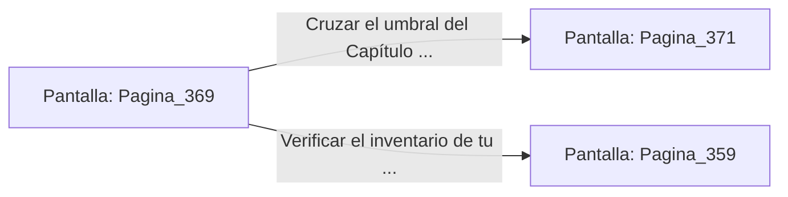

# 📺 Nodo Pantalla: `Pagina_369`

[[Index|⬅️ Índice]] | Fichero Origen: [[sample_eligejuego-code_capitulo_19_mpl|📄 sample/eligejuego-code/capitulo_19.mpl]]

**Narrativa y Encabezado:**
> PÁGINA 369: LOS ESQUEMAS DE LAS 600 CÁMARAS
> 
> Revisas los esquemas holográficos desplegados en el altar del Cronoclave. Los planos confirman que has superado con éxito las trampas y guardianes de las primeras 370 cámaras del complejo.
> 
> El mapa indica además que el acceso a las últimas cámaras del Santuario Final requerirá la máxima potencia de tu arma de fase y la utilización de todos los elixires recabados.
> 
> Con la información asimilada en tu memoria óptica, pones rumbo al Capítulo 20.

## 📋 Desglose de Instrucciones de Opciones
### `OPCION "Cruzar el umbral del Capítulo 20 rumbo al Santuario Final" CON_ACCION TRANSICIONAR_A Pagina_371`
* **Instrucción:** `OPCION` *(Manual: Mapea una entrada o botón interactivo de usuario. Vincular una acción como la invocación de una función C1, un método C2 o una transición C3.)*
* **Efecto de Control:** Dispara `TRANSICIONAR_A` hacia [[Pantalla_Pagina_371|📺 Pagina_371]]
### `OPCION "Verificar el inventario de tu equipo médico" CON_ACCION TRANSICIONAR_A Pagina_359`
* **Instrucción:** `OPCION` *(Manual: Mapea una entrada o botón interactivo de usuario. Vincular una acción como la invocación de una función C1, un método C2 o una transición C3.)*
* **Efecto de Control:** Dispara `TRANSICIONAR_A` hacia [[Pantalla_Pagina_359|📺 Pagina_359]]

## 📊 Diagrama de Flujo e Interacción (Mermaid)

