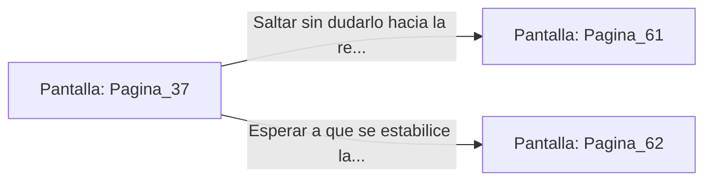

# 📺 Nodo Pantalla: `Pagina_37`

[[Index|⬅️ Índice]] | Fichero Origen: [[sample_eligejuego-code_capitulo_03_mpl|📄 sample/eligejuego-code/capitulo_03.mpl]]

**Narrativa y Encabezado:**
> PÁGINA 37: SALTO A LA PLATAFORMA
> 
> Calculas la distancia, tomas carrerilla y te lanzas al vacío. Tu cuerpo impacta contra la plataforma metálica suspendida en el centro del foso; las cadenas rechinan violentamente, pero aguantan el peso suplementario.
> 
> Desde esta posición elevada divisas en la pared de enfrente una pequeña repisa con una escotilla de inspección que no figuraba en ningún mapa. Sin embargo, el balanceo de la plataforma amenaza con hacerte perder el equilibrio en cualquier momento.
> 
> Puedes intentar saltar de inmediato a la repisa secreta o esperar a que el balanceo se estabilice para saltar hacia el pasillo principal.

## 📋 Desglose de Instrucciones de Opciones
### `OPCION "Saltar sin dudarlo hacia la repisa de la escotilla secreta" CON_ACCION TRANSICIONAR_A Pagina_61`
* **Instrucción:** `OPCION` *(Manual: Mapea una entrada o botón interactivo de usuario. Vincular una acción como la invocación de una función C1, un método C2 o una transición C3.)*
* **Efecto de Control:** Dispara `TRANSICIONAR_A` hacia [[Pantalla_Pagina_61|📺 Pagina_61]]
### `OPCION "Esperar a que se estabilice la plataforma y saltar al pasillo principal" CON_ACCION TRANSICIONAR_A Pagina_62`
* **Instrucción:** `OPCION` *(Manual: Mapea una entrada o botón interactivo de usuario. Vincular una acción como la invocación de una función C1, un método C2 o una transición C3.)*
* **Efecto de Control:** Dispara `TRANSICIONAR_A` hacia [[Pantalla_Pagina_62|📺 Pagina_62]]

## 📊 Diagrama de Flujo e Interacción (Mermaid)

