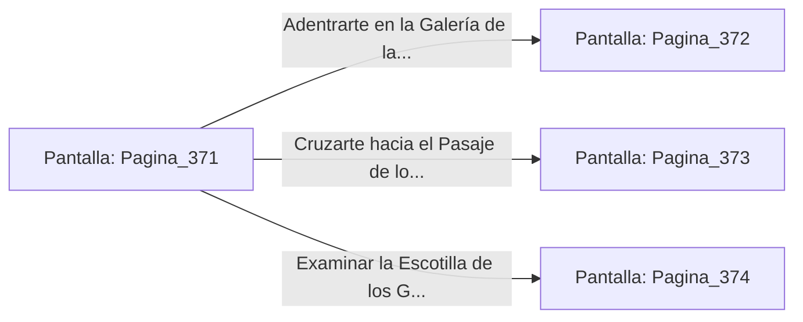

# 📺 Nodo Pantalla: `Pagina_371`

[[Index|⬅️ Índice]] | Fichero Origen: [[sample_eligejuego-code_capitulo_20_mpl|📄 sample/eligejuego-code/capitulo_20.mpl]]

**Narrativa y Encabezado:**
> PÁGINA 371: LA CALZADA DE LOS SANTUARIOS
> 
> Avanzas por la majestuosa calzada de mármol negro que conecta el Cronoclave Maestro con los Santuarios de la Convergencia Final. A ambos lados del camino, columnas de piedra pulida sostienen bóvedas transparentes que revelan la inmensidad del complejo subterráneo de Aethelgard, iluminado por corrientes de éter dorado que fluyen en perfecta armonía.
> 
> Tu Brazal de Convergencia confirma que la red espacio-temporal ha alcanzado un nivel de estabilidad óptimo en las primeras 370 cámaras. Sin embargo, en el ápice de este sector, la Bóveda de los Antiguos Custodios permanece bajo un protocolo de sellado secundario que requiere la verificación de tres llaves de fase.
> 
> Frente a ti se despliegan tres accesos monumentales: la Galería de las Reliquias Olvidadas, el Pasaje de los Espejos Arcanos y la Escotilla de los Generadores del Ápice.

## 📋 Desglose de Instrucciones de Opciones
### `OPCION "Adentrarte en la Galería de las Reliquias Olvidadas" CON_ACCION TRANSICIONAR_A Pagina_372`
* **Instrucción:** `OPCION` *(Manual: Mapea una entrada o botón interactivo de usuario. Vincular una acción como la invocación de una función C1, un método C2 o una transición C3.)*
* **Efecto de Control:** Dispara `TRANSICIONAR_A` hacia [[Pantalla_Pagina_372|📺 Pagina_372]]
### `OPCION "Cruzarte hacia el Pasaje de los Espejos Arcanos" CON_ACCION TRANSICIONAR_A Pagina_373`
* **Instrucción:** `OPCION` *(Manual: Mapea una entrada o botón interactivo de usuario. Vincular una acción como la invocación de una función C1, un método C2 o una transición C3.)*
* **Efecto de Control:** Dispara `TRANSICIONAR_A` hacia [[Pantalla_Pagina_373|📺 Pagina_373]]
### `OPCION "Examinar la Escotilla de los Generadores del Ápice" CON_ACCION TRANSICIONAR_A Pagina_374`
* **Instrucción:** `OPCION` *(Manual: Mapea una entrada o botón interactivo de usuario. Vincular una acción como la invocación de una función C1, un método C2 o una transición C3.)*
* **Efecto de Control:** Dispara `TRANSICIONAR_A` hacia [[Pantalla_Pagina_374|📺 Pagina_374]]

## 📊 Diagrama de Flujo e Interacción (Mermaid)

