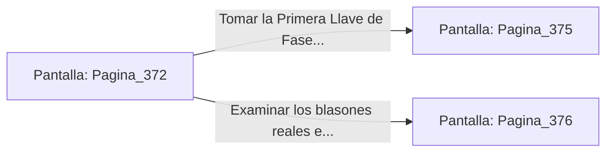

# 📺 Nodo Pantalla: `Pagina_372`

[[Index|⬅️ Índice]] | Fichero Origen: [[sample_eligejuego-code_capitulo_20_mpl|📄 sample/eligejuego-code/capitulo_20.mpl]]

**Narrativa y Encabezado:**
> PÁGINA 372: LA GALERÍA DE LAS RELIQUIAS OLVIDADAS
> 
> Ingresas en una nave abovedada donde descansan en hornacinas de cristal las armas y enseñas de los primeros reyes de Aethelgard. Un silencio reverente envuelve la sala, interrumpido solo por el humear sutil de las antorchas de fuego alquímico.
> 
> En la peana central brilla la Primera Llave de Fase y un frasco de tónico regenerativo concentrado que recarga al cien por cien la vitalidad de tu armadura.

## 📋 Desglose de Instrucciones de Opciones
### `OPCION "Tomar la Primera Llave de Fase y el tónico regenerativo" CON_ACCION TRANSICIONAR_A Pagina_375`
* **Instrucción:** `OPCION` *(Manual: Mapea una entrada o botón interactivo de usuario. Vincular una acción como la invocación de una función C1, un método C2 o una transición C3.)*
* **Efecto de Control:** Dispara `TRANSICIONAR_A` hacia [[Pantalla_Pagina_375|📺 Pagina_375]]
### `OPCION "Examinar los blasones reales en busca de pasajes ocultos" CON_ACCION TRANSICIONAR_A Pagina_376`
* **Instrucción:** `OPCION` *(Manual: Mapea una entrada o botón interactivo de usuario. Vincular una acción como la invocación de una función C1, un método C2 o una transición C3.)*
* **Efecto de Control:** Dispara `TRANSICIONAR_A` hacia [[Pantalla_Pagina_376|📺 Pagina_376]]

## 📊 Diagrama de Flujo e Interacción (Mermaid)

