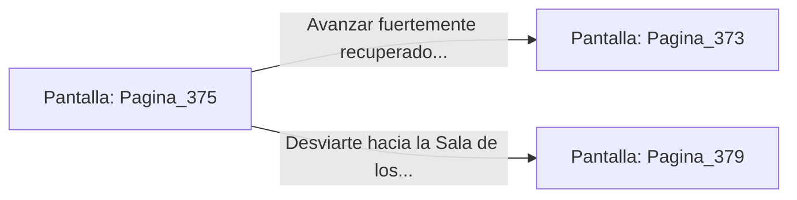

# 📺 Nodo Pantalla: `Pagina_375`

[[Index|⬅️ Índice]] | Fichero Origen: [[sample_eligejuego-code_capitulo_20_mpl|📄 sample/eligejuego-code/capitulo_20.mpl]]

**Narrativa y Encabezado:**
> PÁGINA 375: LA PRIMERA LLAVE DE FASE
> 
> Adosas la Primera Llave de Fase a la ranura lateral de tu Brazal de Convergencia. Un impulso de luz dorada confirma la recepción del código y desbloquea el primer cerrojo místico de la Bóveda de los Antiguos Custodios.
> 
> Consumes el tónico regenerativo, sintiendo cómo una ola de calor reconstituyente repara las contusiones y devuelve la energía máxima a tus músculos fatigados.
> 
> Con las fuerzas recuperadas y la primera llave asegurada, pones rumbo hacia el Pasaje de los Espejos o la Sala de los Generadores.

## 📋 Desglose de Instrucciones de Opciones
### `OPCION "Avanzar fuertemente recuperado hacia el Pasaje de los Espejos" CON_ACCION TRANSICIONAR_A Pagina_373`
* **Instrucción:** `OPCION` *(Manual: Mapea una entrada o botón interactivo de usuario. Vincular una acción como la invocación de una función C1, un método C2 o una transición C3.)*
* **Efecto de Control:** Dispara `TRANSICIONAR_A` hacia [[Pantalla_Pagina_373|📺 Pagina_373]]
### `OPCION "Desviarte hacia la Sala de los Generadores del Ápice" CON_ACCION TRANSICIONAR_A Pagina_379`
* **Instrucción:** `OPCION` *(Manual: Mapea una entrada o botón interactivo de usuario. Vincular una acción como la invocación de una función C1, un método C2 o una transición C3.)*
* **Efecto de Control:** Dispara `TRANSICIONAR_A` hacia [[Pantalla_Pagina_379|📺 Pagina_379]]

## 📊 Diagrama de Flujo e Interacción (Mermaid)

