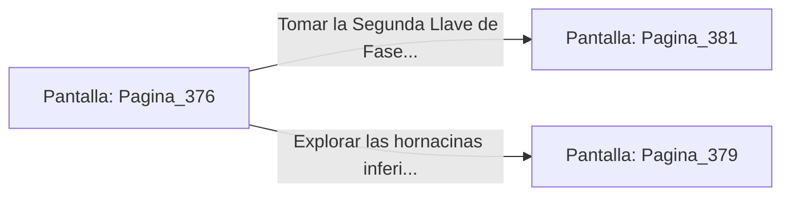

# 📺 Nodo Pantalla: `Pagina_376`

[[Index|⬅️ Índice]] | Fichero Origen: [[sample_eligejuego-code_capitulo_20_mpl|📄 sample/eligejuego-code/capitulo_20.mpl]]

**Narrativa y Encabezado:**
> PÁGINA 376: EL PASAJE SECRETOS DE LOS BLASONES
> 
> Presionas el escudo de armas del Rey Fundador y la pared de granito gira sobre un eje central, revelando un túnel privado que bordea los espejos arcanos sin llamar la atención de las defensas mnemónicas.
> 
> Al final del pasaje encuentras un cofre blindado con la Segunda Llave de Fase en su interior.

## 📋 Desglose de Instrucciones de Opciones
### `OPCION "Tomar la Segunda Llave de Fase y salir a la Bóveda del Ápice" CON_ACCION TRANSICIONAR_A Pagina_381`
* **Instrucción:** `OPCION` *(Manual: Mapea una entrada o botón interactivo de usuario. Vincular una acción como la invocación de una función C1, un método C2 o una transición C3.)*
* **Efecto de Control:** Dispara `TRANSICIONAR_A` hacia [[Pantalla_Pagina_381|📺 Pagina_381]]
### `OPCION "Explorar las hornacinas inferiores del túnel" CON_ACCION TRANSICIONAR_A Pagina_379`
* **Instrucción:** `OPCION` *(Manual: Mapea una entrada o botón interactivo de usuario. Vincular una acción como la invocación de una función C1, un método C2 o una transición C3.)*
* **Efecto de Control:** Dispara `TRANSICIONAR_A` hacia [[Pantalla_Pagina_379|📺 Pagina_379]]

## 📊 Diagrama de Flujo e Interacción (Mermaid)

