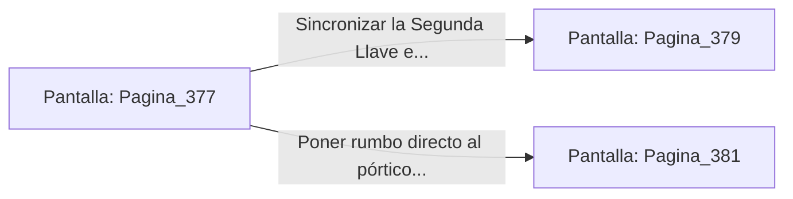

# 📺 Nodo Pantalla: `Pagina_377`

[[Index|⬅️ Índice]] | Fichero Origen: [[sample_eligejuego-code_capitulo_20_mpl|📄 sample/eligejuego-code/capitulo_20.mpl]]

**Narrativa y Encabezado:**
> PÁGINA 377: LA DESTRUCCIÓN DEL ECO MNEMÓNICO
> 
> Descargas una ráfaga de aceleración del Rifle Cronal contra la superficie del espejo. La vibración de los proyectiles quiebra el cuarzo arcano antes de que el eco del Centinela complete su materialización, disolviéndolo en una nube de polvo de cristal.
> 
> Entre las astillas del espejo destruido descubres la Segunda Llave de Fase, la cual brilla con una intensa luminiscencia azulina.
> 
> Recoges la reliquia y la conectas a tu Brazal, asegurando dos de los tres códigos necesarios para ingresar al santuario final.

## 📋 Desglose de Instrucciones de Opciones
### `OPCION "Sincronizar la Segunda Llave e ir a la Sala de Generadores" CON_ACCION TRANSICIONAR_A Pagina_379`
* **Instrucción:** `OPCION` *(Manual: Mapea una entrada o botón interactivo de usuario. Vincular una acción como la invocación de una función C1, un método C2 o una transición C3.)*
* **Efecto de Control:** Dispara `TRANSICIONAR_A` hacia [[Pantalla_Pagina_379|📺 Pagina_379]]
### `OPCION "Poner rumbo directo al pórtico de la Bóveda del Ápice" CON_ACCION TRANSICIONAR_A Pagina_381`
* **Instrucción:** `OPCION` *(Manual: Mapea una entrada o botón interactivo de usuario. Vincular una acción como la invocación de una función C1, un método C2 o una transición C3.)*
* **Efecto de Control:** Dispara `TRANSICIONAR_A` hacia [[Pantalla_Pagina_381|📺 Pagina_381]]

## 📊 Diagrama de Flujo e Interacción (Mermaid)

