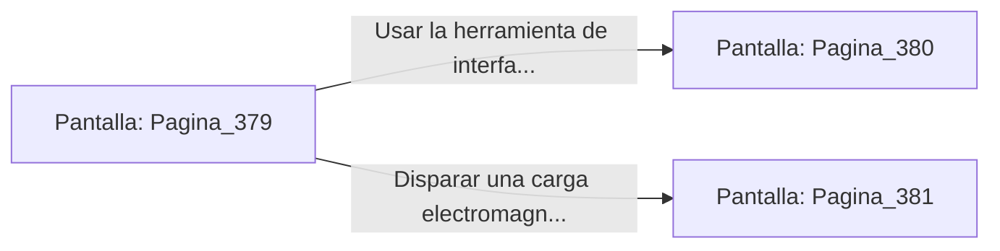

# 📺 Nodo Pantalla: `Pagina_379`

[[Index|⬅️ Índice]] | Fichero Origen: [[sample_eligejuego-code_capitulo_20_mpl|📄 sample/eligejuego-code/capitulo_20.mpl]]

**Narrativa y Encabezado:**
> PÁGINA 379: LA SALA DE GENERADORES DEL ÁPICE
> 
> Penetras en la imponente Sala de Generadores del Ápice. Tres turbinas de titanio giran en torno a una columna de energía dorada, generando el campo de contención para la Bóveda de los Custodios.
> 
> En la consola de control central reposa la Tercera Llave de Fase sobre un pedestal protegido por un campo de fuerza secundario.
> 
> Tienes la opción de usar tu herramienta de interfaz para anular el campo de fuerza secundario o usar una carga de pulso electromagnético para sobrecargar la consola.

## 📋 Desglose de Instrucciones de Opciones
### `OPCION "Usar la herramienta de interfaz para anular el campo de fuerza" CON_ACCION TRANSICIONAR_A Pagina_380`
* **Instrucción:** `OPCION` *(Manual: Mapea una entrada o botón interactivo de usuario. Vincular una acción como la invocación de una función C1, un método C2 o una transición C3.)*
* **Efecto de Control:** Dispara `TRANSICIONAR_A` hacia [[Pantalla_Pagina_380|📺 Pagina_380]]
### `OPCION "Disparar una carga electromagnética contra la consola" CON_ACCION TRANSICIONAR_A Pagina_381`
* **Instrucción:** `OPCION` *(Manual: Mapea una entrada o botón interactivo de usuario. Vincular una acción como la invocación de una función C1, un método C2 o una transición C3.)*
* **Efecto de Control:** Dispara `TRANSICIONAR_A` hacia [[Pantalla_Pagina_381|📺 Pagina_381]]

## 📊 Diagrama de Flujo e Interacción (Mermaid)

