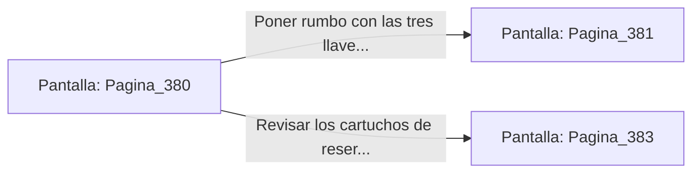

# 📺 Nodo Pantalla: `Pagina_380`

[[Index|⬅️ Índice]] | Fichero Origen: [[sample_eligejuego-code_capitulo_20_mpl|📄 sample/eligejuego-code/capitulo_20.mpl]]

**Narrativa y Encabezado:**
> PÁGINA 380: LA OBTENCIÓN DE LA TERCERA LLAVE
> 
> Inyectas el código de anulación en el pedestal con tu Brazal. El campo de fuerza se disipa suavemente y te apoderas de la Tercera Llave de Fase.
> 
> Con las tres llaves en tu poder, las defensas de la Bóveda del Ápice quedan totalmente desactivadas a tu paso.

## 📋 Desglose de Instrucciones de Opciones
### `OPCION "Poner rumbo con las tres llaves a la Bóveda del Ápice" CON_ACCION TRANSICIONAR_A Pagina_381`
* **Instrucción:** `OPCION` *(Manual: Mapea una entrada o botón interactivo de usuario. Vincular una acción como la invocación de una función C1, un método C2 o una transición C3.)*
* **Efecto de Control:** Dispara `TRANSICIONAR_A` hacia [[Pantalla_Pagina_381|📺 Pagina_381]]
### `OPCION "Revisar los cartuchos de reserva del generador" CON_ACCION TRANSICIONAR_A Pagina_383`
* **Instrucción:** `OPCION` *(Manual: Mapea una entrada o botón interactivo de usuario. Vincular una acción como la invocación de una función C1, un método C2 o una transición C3.)*
* **Efecto de Control:** Dispara `TRANSICIONAR_A` hacia [[Pantalla_Pagina_383|📺 Pagina_383]]

## 📊 Diagrama de Flujo e Interacción (Mermaid)

