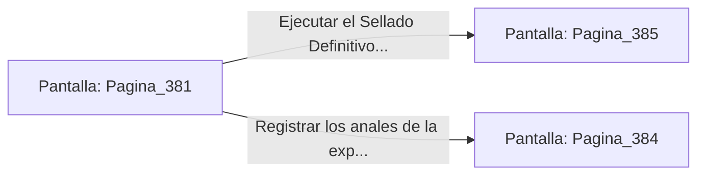

# 📺 Nodo Pantalla: `Pagina_381`

[[Index|⬅️ Índice]] | Fichero Origen: [[sample_eligejuego-code_capitulo_20_mpl|📄 sample/eligejuego-code/capitulo_20.mpl]]

**Narrativa y Encabezado:**
> PÁGINA 381: LA BÓVEDA DE LOS ANTIGUOS CUSTODIOS
> 
> Llegas al imponente pórtico de la Bóveda de los Antiguos Custodios. Sincronizas las tres Llaves de Fase en los zócalos del portal de mármol negro; los cerrojos de titanio se retraen con un sonido atronador y las dobles hojas blindadas se abren de par en par.
> 
> En el centro de la bóveda flota el Gran Núcleo de la Convergencia Final, el nodo maestro que enlaza la totalidad de las 600 Cámaras del proyecto.
> 
> Un panel de administración ancestral te permite ejecutar el Sellado Definitivo de Aethelgard o registrar los anales completos de la expedición.

## 📋 Desglose de Instrucciones de Opciones
### `OPCION "Ejecutar el Sellado Definitivo de Aethelgard en el panel maestro" CON_ACCION TRANSICIONAR_A Pagina_385`
* **Instrucción:** `OPCION` *(Manual: Mapea una entrada o botón interactivo de usuario. Vincular una acción como la invocación de una función C1, un método C2 o una transición C3.)*
* **Efecto de Control:** Dispara `TRANSICIONAR_A` hacia [[Pantalla_Pagina_385|📺 Pagina_385]]
### `OPCION "Registrar los anales de la expedición en la memoria de tu Brazal" CON_ACCION TRANSICIONAR_A Pagina_384`
* **Instrucción:** `OPCION` *(Manual: Mapea una entrada o botón interactivo de usuario. Vincular una acción como la invocación de una función C1, un método C2 o una transición C3.)*
* **Efecto de Control:** Dispara `TRANSICIONAR_A` hacia [[Pantalla_Pagina_384|📺 Pagina_384]]

## 📊 Diagrama de Flujo e Interacción (Mermaid)

