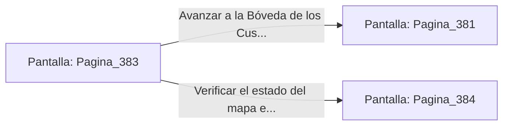

# 📺 Nodo Pantalla: `Pagina_383`

[[Index|⬅️ Índice]] | Fichero Origen: [[sample_eligejuego-code_capitulo_20_mpl|📄 sample/eligejuego-code/capitulo_20.mpl]]

**Narrativa y Encabezado:**
> PÁGINA 383: REABASTECIMIENTO EN LOS GENERADORES
> 
> Revisas las cajas de reserva junto a las turbinas del generador y recuperas dos células de éter militar de alto flujo y una granada de fragmentación arcana.
> 
> Equipas las células en tu arnés, sintiendo la energía al máximo nivel posible en tu armamento.
> 
> Con todo el equipo a punto, te diriges al pórtico de la Bóveda de los Custodios.

## 📋 Desglose de Instrucciones de Opciones
### `OPCION "Avanzar a la Bóveda de los Custodios con el equipo al máximo" CON_ACCION TRANSICIONAR_A Pagina_381`
* **Instrucción:** `OPCION` *(Manual: Mapea una entrada o botón interactivo de usuario. Vincular una acción como la invocación de una función C1, un método C2 o una transición C3.)*
* **Efecto de Control:** Dispara `TRANSICIONAR_A` hacia [[Pantalla_Pagina_381|📺 Pagina_381]]
### `OPCION "Verificar el estado del mapa en tu Brazal" CON_ACCION TRANSICIONAR_A Pagina_384`
* **Instrucción:** `OPCION` *(Manual: Mapea una entrada o botón interactivo de usuario. Vincular una acción como la invocación de una función C1, un método C2 o una transición C3.)*
* **Efecto de Control:** Dispara `TRANSICIONAR_A` hacia [[Pantalla_Pagina_384|📺 Pagina_384]]

## 📊 Diagrama de Flujo e Interacción (Mermaid)

