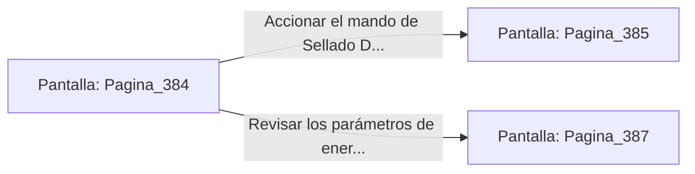

# 📺 Nodo Pantalla: `Pagina_384`

[[Index|⬅️ Índice]] | Fichero Origen: [[sample_eligejuego-code_capitulo_20_mpl|📄 sample/eligejuego-code/capitulo_20.mpl]]

**Narrativa y Encabezado:**
> PÁGINA 384: LOS ANALES DE AETHELGARD
> 
> Descargas los anales históricos completos de la ciudadela en tu Brazal de Convergencia. La base de datos documenta cada héroe, batalla y descubrimiento desde la creación del Cronoclave.
> 
> Con la información a buen recaudo, te aproximas al panel central para culminar tu hazaña.

## 📋 Desglose de Instrucciones de Opciones
### `OPCION "Accionar el mando de Sellado Definitivo en el panel" CON_ACCION TRANSICIONAR_A Pagina_385`
* **Instrucción:** `OPCION` *(Manual: Mapea una entrada o botón interactivo de usuario. Vincular una acción como la invocación de una función C1, un método C2 o una transición C3.)*
* **Efecto de Control:** Dispara `TRANSICIONAR_A` hacia [[Pantalla_Pagina_385|📺 Pagina_385]]
### `OPCION "Revisar los parámetros de energía del Núcleo" CON_ACCION TRANSICIONAR_A Pagina_387`
* **Instrucción:** `OPCION` *(Manual: Mapea una entrada o botón interactivo de usuario. Vincular una acción como la invocación de una función C1, un método C2 o una transición C3.)*
* **Efecto de Control:** Dispara `TRANSICIONAR_A` hacia [[Pantalla_Pagina_387|📺 Pagina_387]]

## 📊 Diagrama de Flujo e Interacción (Mermaid)

