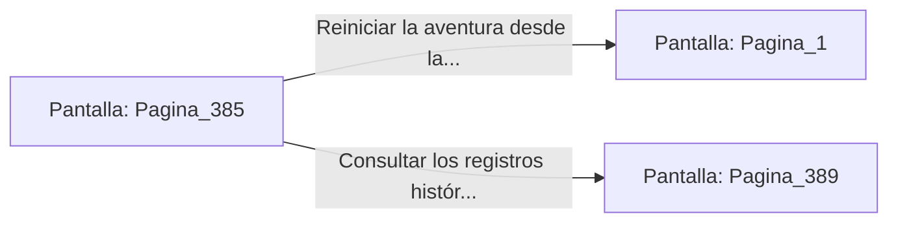

# 📺 Nodo Pantalla: `Pagina_385`

[[Index|⬅️ Índice]] | Fichero Origen: [[sample_eligejuego-code_capitulo_20_mpl|📄 sample/eligejuego-code/capitulo_20.mpl]]

**Narrativa y Encabezado:**
> PÁGINA 385: EL SELLADO DEFINITIVO
> 
> Accionas el mando maestro de la consola. El Gran Núcleo emite un haz de luz dorada que recorre los cimientos de la ciudadela, unificando las frecuencias de todas las cámaras y estabilizando el tejido de la realidad para siempre.
> 
> El zumbido del Cronoclave da paso a un tono dulce y armónico que resuena en las profundidades de Aethelgard. Las luces de la victoria se encienden a lo largo del horizonte subterráneo.
> 
> Has completado con éxito la aventura a través del Cronoclave de las Sombras, salvando las líneas temporales y convirtiéndote en leyenda.

## 📋 Desglose de Instrucciones de Opciones
### `OPCION "Reiniciar la aventura desde la Página 1" CON_ACCION TRANSICIONAR_A Pagina_1`
* **Instrucción:** `OPCION` *(Manual: Mapea una entrada o botón interactivo de usuario. Vincular una acción como la invocación de una función C1, un método C2 o una transición C3.)*
* **Efecto de Control:** Dispara `TRANSICIONAR_A` hacia [[Pantalla_Pagina_1|📺 Pagina_1]]
### `OPCION "Consultar los registros históricos finales de la hazaña" CON_ACCION TRANSICIONAR_A Pagina_389`
* **Instrucción:** `OPCION` *(Manual: Mapea una entrada o botón interactivo de usuario. Vincular una acción como la invocación de una función C1, un método C2 o una transición C3.)*
* **Efecto de Control:** Dispara `TRANSICIONAR_A` hacia [[Pantalla_Pagina_389|📺 Pagina_389]]

## 📊 Diagrama de Flujo e Interacción (Mermaid)

