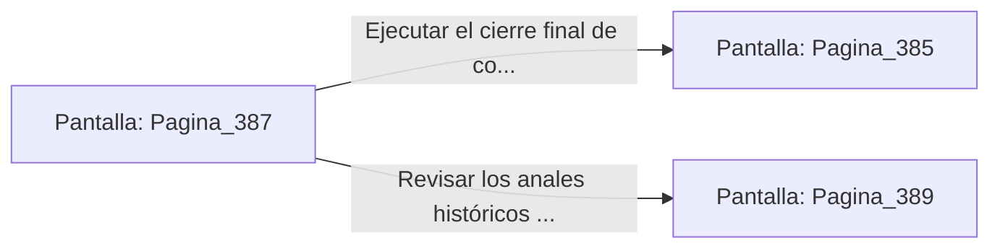

# 📺 Nodo Pantalla: `Pagina_387`

[[Index|⬅️ Índice]] | Fichero Origen: [[sample_eligejuego-code_capitulo_20_mpl|📄 sample/eligejuego-code/capitulo_20.mpl]]

**Narrativa y Encabezado:**
> PÁGINA 387: LA VERIFICACIÓN DE LÍNEAS TEMPORALES
> 
> Compruebas los medidores de flujo temporal en la pantalla holográfica. Las 600 Cámaras del proyecto muestran lecturas de estabilidad del cien por cien sin anomalías ni firmas de corrupción espectral.
> 
> Satisfecho con los resultados, ejecutas la orden de cierre de las compuertas de seguridad del complejo.
> 
> Con la misión cumplida, estás listo para dar por concluida la epopeya.

## 📋 Desglose de Instrucciones de Opciones
### `OPCION "Ejecutar el cierre final de compuertas y culminar la hazaña" CON_ACCION TRANSICIONAR_A Pagina_385`
* **Instrucción:** `OPCION` *(Manual: Mapea una entrada o botón interactivo de usuario. Vincular una acción como la invocación de una función C1, un método C2 o una transición C3.)*
* **Efecto de Control:** Dispara `TRANSICIONAR_A` hacia [[Pantalla_Pagina_385|📺 Pagina_385]]
### `OPCION "Revisar los anales históricos archivados" CON_ACCION TRANSICIONAR_A Pagina_389`
* **Instrucción:** `OPCION` *(Manual: Mapea una entrada o botón interactivo de usuario. Vincular una acción como la invocación de una función C1, un método C2 o una transición C3.)*
* **Efecto de Control:** Dispara `TRANSICIONAR_A` hacia [[Pantalla_Pagina_389|📺 Pagina_389]]

## 📊 Diagrama de Flujo e Interacción (Mermaid)

