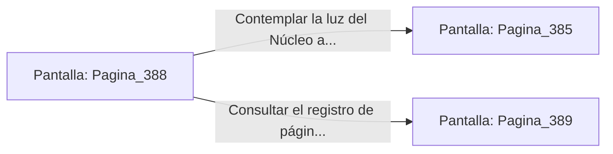

# 📺 Nodo Pantalla: `Pagina_388`

[[Index|⬅️ Índice]] | Fichero Origen: [[sample_eligejuego-code_capitulo_20_mpl|📄 sample/eligejuego-code/capitulo_20.mpl]]

**Narrativa y Encabezado:**
> PÁGINA 388: EL ECO DE LA VICTORIA
> 
> Las alarmas de emergencia se apagan una a una a lo largo de las galerías de Aethelgard. El aire se vuelve limpio y fresco, mientras los antiguos autómatas entran en modo de reposo pacífico.
> 
> Sujetas tu arma de fase en el arnés táctico con la certeza del deber cumplido.

## 📋 Desglose de Instrucciones de Opciones
### `OPCION "Contemplar la luz del Núcleo antes de regresar" CON_ACCION TRANSICIONAR_A Pagina_385`
* **Instrucción:** `OPCION` *(Manual: Mapea una entrada o botón interactivo de usuario. Vincular una acción como la invocación de una función C1, un método C2 o una transición C3.)*
* **Efecto de Control:** Dispara `TRANSICIONAR_A` hacia [[Pantalla_Pagina_385|📺 Pagina_385]]
### `OPCION "Consultar el registro de páginas de la hazaña" CON_ACCION TRANSICIONAR_A Pagina_389`
* **Instrucción:** `OPCION` *(Manual: Mapea una entrada o botón interactivo de usuario. Vincular una acción como la invocación de una función C1, un método C2 o una transición C3.)*
* **Efecto de Control:** Dispara `TRANSICIONAR_A` hacia [[Pantalla_Pagina_389|📺 Pagina_389]]

## 📊 Diagrama de Flujo e Interacción (Mermaid)

