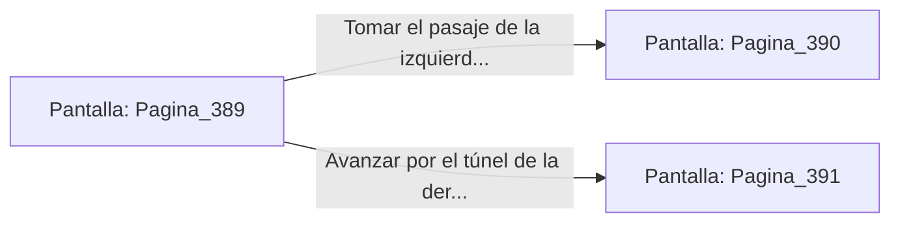

# 📺 Nodo Pantalla: `Pagina_389`

[[Index|⬅️ Índice]] | Fichero Origen: [[sample_eligejuego-code_capitulo_07_prision_cristal_mpl|📄 sample/eligejuego-code/capitulo_07_prision_cristal.mpl]]

**Narrativa y Encabezado:**
> Página 389: La Prisión de Cristal
> 
> Columnas de cristal prismático aprisionan las almas de antiguos héroes que intentaron vencer al nigromante. Te encuentras ante una encrucijada en la penumbra de la mazmorra. Debes tomar una decisión.

## 📋 Desglose de Instrucciones de Opciones
### `OPCION "Tomar el pasaje de la izquierda (Página 390)" CON_ACCION TRANSICIONAR_A Pagina_390`
* **Instrucción:** `OPCION` *(Manual: Mapea una entrada o botón interactivo de usuario. Vincular una acción como la invocación de una función C1, un método C2 o una transición C3.)*
* **Efecto de Control:** Dispara `TRANSICIONAR_A` hacia [[Pantalla_Pagina_390|📺 Pagina_390]]
### `OPCION "Avanzar por el túnel de la derecha (Página 391)" CON_ACCION TRANSICIONAR_A Pagina_391`
* **Instrucción:** `OPCION` *(Manual: Mapea una entrada o botón interactivo de usuario. Vincular una acción como la invocación de una función C1, un método C2 o una transición C3.)*
* **Efecto de Control:** Dispara `TRANSICIONAR_A` hacia [[Pantalla_Pagina_391|📺 Pagina_391]]

## 📊 Diagrama de Flujo e Interacción (Mermaid)

