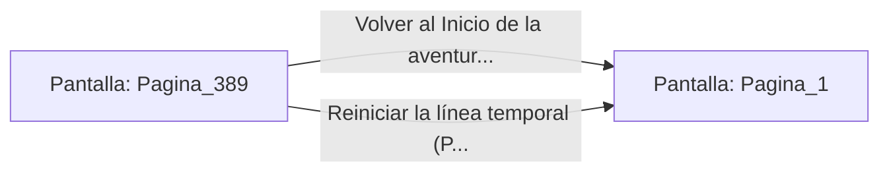

# 📺 Nodo Pantalla: `Pagina_389`

[[Index|⬅️ Índice]] | Fichero Origen: [[sample_eligejuego-code_capitulo_20_mpl|📄 sample/eligejuego-code/capitulo_20.mpl]]

**Narrativa y Encabezado:**
> PÁGINA 389: REGISTRO HISTÓRICO DE AETHELGARD
> 
> Tu hazaña queda grabada en la memoria óptica de la ciudadela y en los registros del Brazal de Convergencia, documentando tu victoria desde el despertar en la Cámara 1 hasta la estabilización de la Cámara 390.
> 
> Las líneas temporales del Imperio Crono han sido unificadas y preservadas para las generaciones futuras.
> 
> Gracias por jugar al librojuego interactivo 'El Cronoclave de las Sombras'.

## 📋 Desglose de Instrucciones de Opciones
### `OPCION "Volver al Inicio de la aventura (Página 1)" CON_ACCION TRANSICIONAR_A Pagina_1`
* **Instrucción:** `OPCION` *(Manual: Mapea una entrada o botón interactivo de usuario. Vincular una acción como la invocación de una función C1, un método C2 o una transición C3.)*
* **Efecto de Control:** Dispara `TRANSICIONAR_A` hacia [[Pantalla_Pagina_1|📺 Pagina_1]]
### `OPCION "Reiniciar la línea temporal (Página 1)" CON_ACCION TRANSICIONAR_A Pagina_1`
* **Instrucción:** `OPCION` *(Manual: Mapea una entrada o botón interactivo de usuario. Vincular una acción como la invocación de una función C1, un método C2 o una transición C3.)*
* **Efecto de Control:** Dispara `TRANSICIONAR_A` hacia [[Pantalla_Pagina_1|📺 Pagina_1]]

## 📊 Diagrama de Flujo e Interacción (Mermaid)

