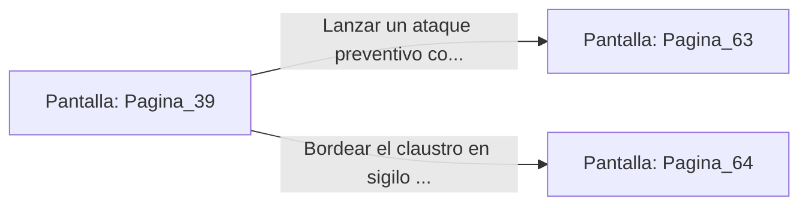

# 📺 Nodo Pantalla: `Pagina_39`

[[Index|⬅️ Índice]] | Fichero Origen: [[sample_eligejuego-code_capitulo_03_mpl|📄 sample/eligejuego-code/capitulo_03.mpl]]

**Narrativa y Encabezado:**
> PÁGINA 39: EL CLAUSTRO DE LOS OBSERVADORES
> 
> Cruzas el pórtico monumental e ingresas en un amplio patio flanqueado por altas arcadas de mármol. En el centro se erige un gran telescopio astral apuntado no al cielo, sino a una falla en el tejido del espacio-tiempo que flota sobre el abismo.
> 
> Tres figuras vestidas con túnicas ceremoniales permanecen en trance alrededor del telescopio, murmurando cánticos en el dialecto antiguo. No parecen haberse percatado aún de tu presencia.
> 
> Tienes la oportunidad de sorprender a los cultistas con un ataque preventivo o bordear el claustro por el pasadizo cubierto para no interrumpiendo su ritual.

## 📋 Desglose de Instrucciones de Opciones
### `OPCION "Lanzar un ataque preventivo contra los tres cultistas" CON_ACCION TRANSICIONAR_A Pagina_63`
* **Instrucción:** `OPCION` *(Manual: Mapea una entrada o botón interactivo de usuario. Vincular una acción como la invocación de una función C1, un método C2 o una transición C3.)*
* **Efecto de Control:** Dispara `TRANSICIONAR_A` hacia [[Pantalla_Pagina_63|📺 Pagina_63]]
### `OPCION "Bordear el claustro en sigilo por el pasadizo cubierto" CON_ACCION TRANSICIONAR_A Pagina_64`
* **Instrucción:** `OPCION` *(Manual: Mapea una entrada o botón interactivo de usuario. Vincular una acción como la invocación de una función C1, un método C2 o una transición C3.)*
* **Efecto de Control:** Dispara `TRANSICIONAR_A` hacia [[Pantalla_Pagina_64|📺 Pagina_64]]

## 📊 Diagrama de Flujo e Interacción (Mermaid)

